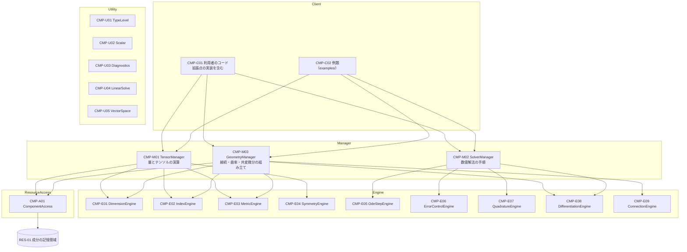

# 1. 概要設計

構成要素への分け方は、Juval Löwy『Righting Software』（Addison-Wesley, 2019）の The Method に従う（[README](README.md)）。
この文書では、変わらないもの（ライブラリの核）と変わりうるもの（変動性）を分け、変動性ごとに構成要素を置き、構成要素の間の呼び出し方の規則を決める。

## 1.1 システムの範囲

tensorcheck は、次の 2 つを提供する。

1. **型の検査**：次元・テンソルの構造（階数と形、添字の上下、空間と座標系、対称性）をコンパイル時に検査する量とテンソル（FR-01〜FR-13）
2. **幾何**：テンソル場、計量テンソルから求める接続（Christoffel 記号）と曲率（Riemann・Ricci・スカラー曲率・Einstein）、共変微分。微分は自動微分で求める（FR-15、FR-16、FR-25〜FR-27）
3. **数値計算**：1 と 2 の量とテンソルを、検査を保ったまま扱う数値解法（常微分方程式、定積分、数値微分。FR-18〜FR-22）

利用者のコード（Client）は、量とテンソルを作って計算し、数値解法を呼ぶ。利用者は、拡張点（trait）を実装して、自分の単位系・空間・座標系・計量テンソルを足せる（UC-06）。

### 既存のクレートとの違い（OPEN-02 の結論）

2026-10-12 に crates.io と各リポジトリで確かめた。

| 分野 | クレート（版、最終更新） | できること | tensorcheck との違い |
| --- | --- | --- | --- |
| 次元 | uom（0.38.0、2026-02） | stable で使える次元解析。実行時のコストがない。SI を同梱。最もよく使われている | スカラーの次元だけを扱う。テンソルの構造は扱わない |
| 次元 | dimensioned（0.8.0、2022-04） | stable で使える次元解析 | 同上 |
| 次元 | diman（0.6.0、2026-08） | const generics による次元解析。エラー文が読みやすい | unstable な機能が 4 つ必要で、stable で使えない |
| テンソル | differential-geometry（0.3.1、2019-07） | 任意の多様体上のテンソル。次元数 $`n`$ と座標系を型で持つ | もっとも近い。ただし、物理の次元、対称性、ラベルによる縮約（Einstein の規約）がない。2019 年から更新がない |
| 微分方程式 | diffsol（0.17.1、2026-09） | BDF、SDIRK/ESDIRK（TR-BDF2、ESDIRK34）、陽的 Runge–Kutta（TSIT45） | 状態は次元を持たない数値の並び。次元の検査はそこで途切れる |
| 微分方程式 | russell_ode（3.3.1、2026-09） | DoPri5、DoPri8、後退 Euler 法、Radau5 | 同上。Rust 以外のライブラリ（OpenBLAS など）に依存し、`no_std` で使えない |
| 微分方程式 | ode_solvers（0.6.2、2026-06） | Dopri5、Dop853 | 同上。硬い方程式に対応しない |
| 積分 | bilby（0.3.0、2026-07）、integrate（0.3.1、2026-05）、quad-rs（0.5.0、2026-09） | Gauss–Legendre、Gauss–Kronrod、Simpson、Romberg など（クレートによって違う） | 被積分関数は次元を持たない数値 |

- 次元とテンソルの構造を 1 つの型で扱うクレートは見つからなかった。
- 次元つきの量のまま解ける数値解法は見つからなかった。
- Rust で Rosenbrock 法を実装したクレートは見つからなかった。

この比較は README（英語）にも書く。

## 1.2 変わらないもの（ライブラリの核）

次の規則は物理と数学の規則そのものなので、変動性として扱わない。型の規則として固定する。

| 規則 | 内容 |
| --- | --- |
| 次元の代数 | 掛けると次元の指数が足され、割ると引かれる。足し算・引き算は同じ次元どうしだけ |
| 添字の代数 | 縮約は、同じ空間・同じ座標系の、上付きと下付きの組だけ。上げ下げには、その空間の計量テンソルを使う |
| テンソルの足し算 | 次元・添字の並び（空間・座標系・上下）・対称性がすべて同じものどうしだけ |
| 成分の次元 | $`[T^{a}{}_{b}] = [T]\,[x^a]\,/\,[x^b]`$。添字が増えても同じ規則を繰り返す |
| 座標変換の規則 | 上付きの添字は $`\partial x'^a / \partial x^b`$、下付きの添字は $`\partial x^b / \partial x'^a`$ で変換する |
| 数値計算の次元 | $`\int f\,dx`$ は $`[f]\,[x]`$、$`df/dx`$ は $`[f]\,/\,[x]`$、$`dy/dt = f`$ では $`[f] = [y]\,/\,[t]`$ |
| Levi-Civita 接続と曲率の公式 | $`\Gamma^a{}_{bc} = \tfrac{1}{2} g^{ad}(\partial_b g_{dc} + \partial_c g_{db} - \partial_d g_{bc})`$、$`R^a{}_{bcd} = \partial_c \Gamma^a{}_{db} - \partial_d \Gamma^a{}_{cb} + \Gamma^a{}_{ce}\Gamma^e{}_{db} - \Gamma^a{}_{de}\Gamma^e{}_{cb}`$、$`R_{bd} = R^a{}_{bad}`$、$`R = g^{bd} R_{bd}`$、$`G_{ab} = R_{ab} - \tfrac{1}{2} R\, g_{ab}`$ |
| テンソル性 | テンソルだけが座標変換の規則に従う。Christoffel 記号や、テンソルの偏微分の成分は、ある座標系でだけ意味を持つ（テンソルでない）。テンソルでないものは、座標変換できず、テンソルに足せない。共変微分 $`\nabla_c V^a = \partial_c V^a + \Gamma^a{}_{cb} V^b`$ のように、組み合わせるとテンソルになる |

### 成分ごとに違う次元は、座標系（VOL-04）で吸収する

座標基底の成分の次元は、テンソル全体の次元と、座標系の各座標の次元から決まる。

- 例：極座標 $`(r, \theta)`$ で、速度 $`V^a = dx^a/dt`$ の成分の次元は $`(\mathrm{m\,s^{-1}},\ \mathrm{s^{-1}})`$。
- 例：場空間で、場 $`\phi^1`$ と $`\phi^2`$ の次元が違えば、$`G_{IJ}`$ の成分の次元も添字ごとに違う。

座標系が各座標の次元を宣言すれば、成分の次元はそこから計算できる。テンソル 1 つにつき持つ次元は 1 つのままでよい。

さらに、上付きと下付きを縮約すると座標の次元は打ち消し合う。そのため、縮約の和の各項は同じ次元になる（$`V^a W_a`$ の各項はすべて $`[V]\,[W]`$）。このため、成分は単なる数値の配列で持ち、型は「全体の次元と添字の並び」だけを持てばよい。成分を 1 つ取り出すときだけ、座標を型で指定する（FR-12）。

## 1.3 変動性の分析（VOL）

| ID | 変動性 | 変わり方の例 | 軸 | 封じ込める構成要素 |
| --- | --- | --- | --- | --- |
| VOL-01 | 単位系（基本次元の集合） | SI の 7 次元 → 自然単位系（$`\hbar = c = 1`$、質量次元だけ）→ すべて無次元（$`\hbar = c = G = 1`$） | 利用者 | CMP-E01 DimensionEngine |
| VOL-02 | 単位（基準の単位との換算） | $`\mathrm{m}`$、$`\mathrm{km}`$、$`\mathrm{eV}`$、$`\mathrm{GeV}`$、換算プランク質量 $`M_\mathrm{P}`$ を足す | 利用者 | CMP-E01 DimensionEngine |
| VOL-03 | 添字が属する空間 | 3 次元空間、4 次元時空、$`N`$ 成分の場空間、内部空間。次元数 $`n`$ も空間ごとに違う | 利用者 | CMP-E02 IndexEngine |
| VOL-04 | 座標系（基底） | デカルト、極、球。座標基底か正規直交基底か。場空間では場の選び方（場の再定義） | 利用者 | CMP-E02 IndexEngine |
| VOL-05 | 計量テンソル | 定数（Euclid、Minkowski）→ 位置に依存（曲線座標、場空間の $`G_{IJ}(\phi)`$）。符号の取り方（$`+{-}{-}{-}`$ / $`{-}{+}{+}{+}`$） | 利用者 | CMP-E03 MetricEngine |
| VOL-06 | 対称性の種類 | なし、対称、反対称 → 一部の添字だけ対称 | 利用者、時間 | CMP-E04 SymmetryEngine |
| VOL-07 | 常微分方程式の解法 | RK4、Dormand–Prince 5(4)、leapfrog、Rosenbrock 法 → Radau IIA、BDF（FR-23） | 利用者、時間 | CMP-E05 OdeStepEngine |
| VOL-08 | 誤差の測り方と、刻み幅・分割の調整 | 成分ごとの相対・絶対誤差の混合ノルム → 最大値ノルム。単純な刻み幅の調整 → PI 制御 | 利用者、時間 | CMP-E06 ErrorControlEngine |
| VOL-09 | 定積分の解法 | 台形、Simpson、Romberg、Gauss–Legendre、適応型 Gauss–Kronrod → 無限区間・多次元（FR-24） | 利用者、時間 | CMP-E07 QuadratureEngine |
| VOL-10 | 微分の求め方 | 自動微分（1 階・2 階の双対数）、差分（中心差分、Richardson 補外）→ 複素ステップ微分、逆方向の自動微分 | 利用者、時間 | CMP-E08 DifferentiationEngine |
| VOL-11 | 成分の持ち方 | 密な配列 → 対称性を使った圧縮（FR-17） | 時間 | CMP-A01 ComponentAccess |
| VOL-12 | 数値の型 | `f64`、1 階・2 階の双対数（FR-16）→ `f32` など（FR-28） | 時間 | CMP-U02 Scalar |
| VOL-13 | ユースケースの手順 | 演算の組み合わせ方（縮約・上げ下げ・座標変換の順序）、幾何量の組み立て方（微分 → 接続 → 曲率）、数値解法の進め方（評価 → 1 歩 → 誤差の判定 → 刻みの調整） | 時間 | CMP-M01 TensorManager / CMP-M03 GeometryManager / CMP-M02 SolverManager |
| VOL-14 | 接続 | 計量テンソルから決まる Levi-Civita 接続 → ねじれを持つ接続、利用者が係数を与える接続（OPEN-08） | 利用者、時間 | CMP-E09 ConnectionEngine |

VOL-01 と VOL-02 は同じ構成要素に入れる。単位は単位系の中の換算係数にすぎず、単位系と独立に変わることはあっても、別の規則を持たないため。

## 1.4 変動性として扱わないもの

| 候補 | 扱わない理由 |
| --- | --- |
| §1.2 の規則 | 物理と数学の規則で、変わらない |
| スピノル、Grassmann 数 | テンソルとは変換の規則が違い、別のライブラリになる（00 §0.7） |
| 実行時に階数や次元数が決まるテンソル | コンパイル時の検査という目的と両立しない（00 §0.7） |
| 小さな行列の逆と連立一次方程式の解法 | 計量テンソルの逆、Jacobi 行列の逆、硬い方程式の解法に要る範囲に限られ、方式は安定している（大きさ 4 以下は余因子行列による解析的な式、5 以上は部分ピボット選択つき LU 分解）。Utility（CMP-U04）にまとめる |
| エラー文の書き方 | 書き方の規則は安定している。Utility（CMP-U03）にまとめる |
| 型レベルの整数と並び | 実装の土台で、変わらない。Utility（CMP-U01）にまとめる |

## 1.5 階層構成

Utility はすべての層から使えるので、図では矢印を省く。

### 構成要素の責務

| 構成要素 | 責務 | 変動性 | 主なユースケース |
| --- | --- | --- | --- |
| CMP-C01 利用者のコード | 量とテンソルを作って計算し、数値解法を呼ぶ。拡張点（単位系・単位・空間・座標系・計量テンソル・座標変換）を実装する | — | すべて |
| CMP-C02 例題 | UC-01〜UC-04、UC-07〜UC-09 を実行できる形で示す（FR-14） | — | UC-01〜UC-04、UC-07〜UC-09 |
| CMP-M01 TensorManager | 演算ごとに、各 Engine に結果の型（次元・添字の並び・対称性）を問い合わせ、成分の計算を組み立てる | VOL-13 | UC-01〜UC-06 |
| CMP-M03 GeometryManager | 幾何量を組み立てる：テンソル場と計量テンソルを点で評価し、微分を求め、接続・曲率・共変微分を組み立てる | VOL-13 | UC-09 |
| CMP-M02 SolverManager | 数値解法の手順を進める：右辺や被積分関数の評価 → 1 歩・1 区間の計算 → 誤差の判定 → 刻みや分割の調整 → 失敗の知らせ | VOL-13 | UC-07、UC-08 |
| CMP-E01 DimensionEngine | 次元の掛け算・割り算・一致の判定。単位の換算 | VOL-01、VOL-02 | UC-01、UC-06 |
| CMP-E02 IndexEngine | 添字の並び（空間・座標系・上下・ラベル）の操作。縮約できる組の判定と、結果の添字の並びの計算。成分の次元の計算 | VOL-03、VOL-04 | UC-02〜UC-04 |
| CMP-E03 MetricEngine | 計量テンソルとその逆を使った上げ下げの計算 | VOL-05 | UC-02、UC-03 |
| CMP-E04 SymmetryEngine | 演算の結果の対称性の決定と、対称性の検査 | VOL-06 | UC-03 |
| CMP-E05 OdeStepEngine | 常微分方程式の 1 歩の計算と、誤差の見積もり | VOL-07 | UC-07 |
| CMP-E06 ErrorControlEngine | 誤差の大きさの測り方と、次の刻み幅（または区間の分割）の決定。常微分方程式と積分で共有する | VOL-08 | UC-07、UC-08 |
| CMP-E07 QuadratureEngine | 定積分の公式による計算と、誤差の見積もり | VOL-09 | UC-08 |
| CMP-E08 DifferentiationEngine | 微分の計算：自動微分によるテンソル場の 1 階・2 階の微分と、差分による数値微分・Jacobi 行列 | VOL-10 | UC-07、UC-09 |
| CMP-E09 ConnectionEngine | 計量テンソルとその微分から、接続の係数と Riemann テンソルを計算する | VOL-14 | UC-09 |
| CMP-A01 ComponentAccess | 成分を記憶領域にどう並べるかを隠し、添字の組で読み書きさせる | VOL-11 | すべて |
| CMP-U01 TypeLevel | 型レベルの整数と、型の並び | — | すべて |
| CMP-U02 Scalar | 成分の数値の型の契約と、その実装（`f64`、1 階・2 階の双対数） | VOL-12 | すべて |
| CMP-U03 Diagnostics | 誤りの種類ごとのコンパイルエラーの文（英語。NFR-07） | — | UC-05 |
| CMP-U04 LinearSolve | 小さな行列の逆と連立一次方程式の解法。大きさ 4 以下は余因子行列による解析的な式、5 以上は部分ピボット選択つき LU 分解。計量テンソルの逆、Jacobi 行列の逆、硬い方程式の解法で使う | — | UC-02〜UC-04、UC-07 |
| CMP-U05 VectorSpace | 「足せて、数で掛けられ、大きさを測れる」ものの契約。常微分方程式の状態と、積分の結果が満たす | — | UC-07、UC-08 |

### Manager を 3 つにした理由

ユースケースは、手順の性質で 3 つに分かれる。

- UC-01〜UC-06 は、**式を組み立てる**手順である。どの順に縮約し、どこで上げ下げし、いつ座標を変換するか。
- UC-09 は、**場を微分して幾何量を組み立てる**手順である。点で評価し、微分し、接続を求め、曲率を組み立てる。
- UC-07 と UC-08 は、**反復して近似する**手順である。評価し、1 歩進め、誤差を見て、刻みを変える。

この 3 つは変わる理由が違うので、別の Manager にする。GeometryManager は、縮約や上げ下げが要るときも TensorManager を呼ばず、Engine（E02、E03）を直接使う。

測地線（UC-09）は、利用者の右辺の関数の中で GeometryManager に Christoffel 記号を求めさせ、その関数を SolverManager に渡して解く。組み合わせるのは Client であり、Manager どうしは呼び合わない。

SolverManager は、状態の足し算やスカラー倍を TensorManager に頼まない。状態は CMP-U05 VectorSpace の契約を満たすものとして扱い、量とテンソルはこの契約を実装する。こうすると、Manager どうしの呼び出しが生まれない。また、型の検査（$`[f] = [y]\,/\,[t]`$ など）は、VectorSpace の契約の型の制約として表せる。

### 型の層と値の層

このライブラリでは、各構成要素が 2 つの層で働く。

- **型の層（コンパイル時）**：結果の型を決め、誤りならコンパイルを止める。例：IndexEngine が「この 2 つの添字は縮約できるか」「結果の添字の並びは何か」を trait の解決で計算する。
- **値の層（実行時）**：成分の数値を計算する。例：IndexEngine が縮約する添字の組を決め、ComponentAccess を通して成分を読み、和をとる。

呼び出しの規則（§1.7）は、どちらの層にも同じように適用する。

## 1.6 リソース（RES）

| ID | リソース | 説明 | 使う構成要素 |
| --- | --- | --- | --- |
| RES-01 | 成分の記憶領域 | テンソルの成分を置くメモリ。大きさはコンパイル時に決まり、ヒープを使わない | CMP-A01 ComponentAccess |
| RES-02 | 数値解法の作業領域 | 適応型の積分の区間の一覧など、実行時に大きさが決まるもの。ヒープ（std の `Vec`）を使う | CMP-E06, CMP-E07 |

ファイル・ネットワーク・データベースなどの外部のリソースは使わない。利用者が渡す関数（右辺、被積分関数、計量テンソル、座標変換）は、リソースではなく Client が実装する拡張点として扱う。

## 1.7 利用規則

| 呼び出し元 | 呼んでよい先 | 呼んではいけない先 |
| --- | --- | --- |
| Client | Manager、Utility。拡張点の trait の実装 | Engine、ResourceAccess |
| Manager | Engine、ResourceAccess、Utility | 別の Manager |
| Engine | ResourceAccess、Utility | 別の Engine、Manager |
| ResourceAccess | リソース、Utility | Engine、Manager |
| Utility | 別の Utility | ほかのすべての層 |

- Engine どうしは呼ばない。例：上げ下げ（MetricEngine）で添字の並びが変わるときは、TensorManager が IndexEngine に結果の並びを問い合わせ、MetricEngine に成分の計算を頼む。Rosenbrock 法で Jacobi 行列が要るときは、SolverManager が DifferentiationEngine に求めさせ、OdeStepEngine に渡す。
- 拡張点の trait は、Client が実装し、Engine が使う。trait の定義は Engine の側に置く（依存の向きは Client → Engine の定義）。
- この規則は、モジュールの可視性（`pub(crate)` など）と、CI の検査スクリプトで守る（NFR-11。方式は 03 で決める）。
- `tensorcheck-numerics` の SolverManager は、`tensorcheck` にある DifferentiationEngine を使う。そのため `tensorcheck` は、Engine を内部向けのモジュール（ドキュメントに出さない）で公開する。利用者のコードがこのモジュールを使わないことは、検査スクリプトで確かめる。

## 1.8 クレートの分け方（OPEN-07 の結論）

1 つのリポジトリ（Cargo の workspace）に、2 つのクレートを置く。

| クレート | 含む構成要素 | 依存 |
| --- | --- | --- |
| `tensorcheck` | CMP-M01、CMP-M03、CMP-E01〜E04、CMP-E08、CMP-E09、CMP-A01、CMP-U01〜U05 | なし |
| `tensorcheck-numerics` | CMP-M02、CMP-E05〜E07 | `tensorcheck` |

理由：

- 依存の向きが Cargo で強制される。`tensorcheck` は `tensorcheck-numerics` を参照できないので、型の検査の核が数値計算に依存しないことを、コンパイラが保証する。
- 数値計算が要らない利用者は、`tensorcheck` だけを使える。コンパイル時間も短くなる。
- 同じリポジトリに置くので、両方を同時に変える PR を 1 つにまとめられる。

どちらも std を前提にし、外部のクレートに依存しない（NFR-01。`no_std` は OPEN-09）。
