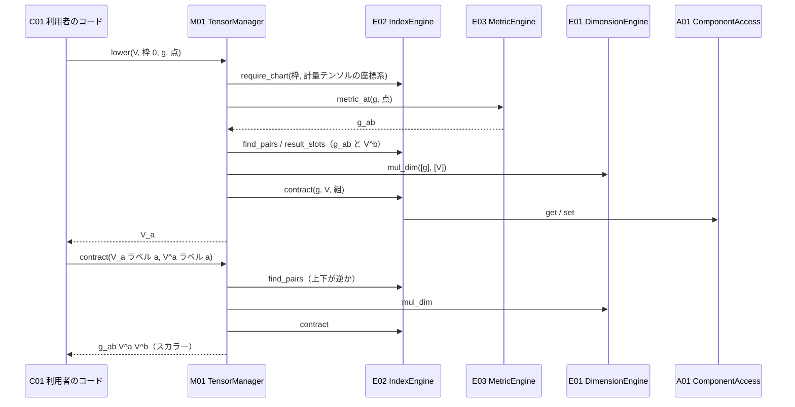
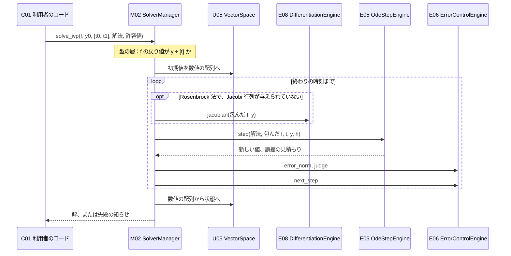
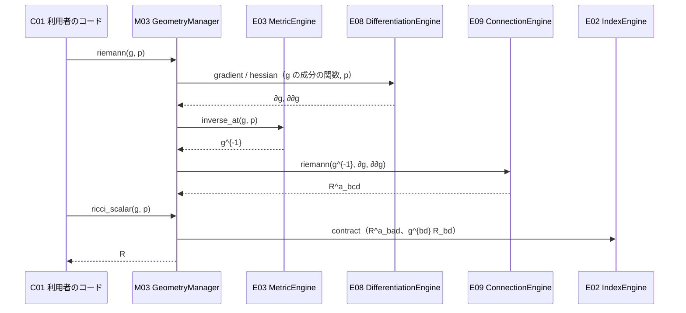

# 2b. 基本設計（内部設計）

01 で決めた構成要素について、責務・契約・コールチェーンを決める。
操作の名前は設計上の名前で、Rust での具体的な書き方（型・trait・メソッドの名前）は 2a と 03 で決める。

## 2b.1 共通の概念

構成要素の契約で使う概念を、先に定義する。

| 概念 | 意味 | 型の層で持つもの | 値の層で持つもの |
| --- | --- | --- | --- |
| 次元 | 単位系の基本次元それぞれの指数の組。例：SI で速度は $`(1, 0, -1, 0, 0, 0, 0)`$ | 単位系、指数の組（型レベルの整数） | なし |
| 添字の枠（slot） | テンソルの 1 つの添字の性質。空間・座標系・上下の 3 つ | 空間、座標系、上下 | なし |
| 枠の並び | テンソルの添字の枠を順に並べたもの。長さが階数 | 枠の型の並び | なし |
| 対称性 | テンソル全体の対称性：なし・対称・反対称 | 対称性の印 | なし |
| テンソル性 | 座標変換の規則に従うか。「テンソル」と「座標系に縛られたもの（テンソルでない）」の 2 種類。Christoffel 記号と、それを含む式は後者 | テンソル性の印 | なし |
| テンソル | 次元・枠の並び・対称性・テンソル性を持つ、成分の集まり。スカラー（次元つきの量）は階数 0 のテンソルとして扱う。テンソルでないもの（Christoffel 記号など）も同じ形で持ち、テンソル性の印で区別する | 次元、枠の並び、対称性、テンソル性、数値の型 | 成分（基準の単位での数値。個数は $`\prod_i n_i`$） |
| テンソル場 | 点を受け取ってテンソルを返す関数。数値の型によらない形で書かれ、同じ定義から値（`f64`）と微分（双対数）が求まる。計量テンソルはテンソル場の一種 | 座標系、返すテンソルの型 | 利用者の関数 |
| 点 | ある座標系での位置。座標ごとに次元が違ってよい（例：$`(r, \theta)`$）。テンソルではない。数値解法の状態として使える（測地線の方程式） | 座標系、数値の型 | 座標の値（$`n`$ 個） |
| ラベル | 式の中で添字につける名前（$`a`$、$`\mu`$、$`I`$ など）。テンソルの型には含めず、式を書くときにだけつける | ラベルの型 | なし |
| ラベルつきの式 | テンソルの各枠にラベルをつけたもの。Einstein の規約で縮約するための形 | テンソルの型、ラベルの並び | テンソルの成分への参照 |
| 状態 | 数値解法で扱う「足せて、数で掛けられるもの」。テンソル、またはテンソルの組 | 各要素の型 | 成分 |

### スカラーをテンソルの一種にする理由

次元つきの量を別の型にすると、「量 × テンソル」「テンソル × 量」の組み合わせごとに規則を書くことになる。階数 0 のテンソルとして扱えば、掛け算・足し算・単位の換算の規則が 1 つで済む。

### テンソル性を型で持つ理由

Christoffel 記号 $`\Gamma^a{}_{bc}`$ や偏微分 $`\partial_c V^a`$ は、成分の並びはテンソルと同じだが、座標変換の規則に従わない。別の型にすると、縮約・成分の取り出しなどの操作をすべて二重に書くことになる。そこで、同じ型にテンソル性の印を持たせ、次の規則で区別する。

| 操作 | 規則 |
| --- | --- |
| 座標変換 | テンソルだけができる。テンソルでないものはコンパイルエラー |
| 足し算・引き算 | テンソル性が同じものどうしだけ |
| 積・縮約 | 両方がテンソルなら結果もテンソル。どちらかがテンソルでなければ、結果もテンソルでない（同じ座標系に縛られる） |
| 共変微分 | ライブラリ（M03）の中で $`\partial V`$ と $`\Gamma V`$ を組み合わせ、結果をテンソルとして返す。利用者が印を付け替える方法は用意しない |

### 対称性を構成のしかたで保証する

対称なテンソルは、独立な成分だけを受け取って作る（例：$`2 \times 2`$ なら $`T_{11}, T_{12}, T_{22}`$ の 3 つ）。そのため、対称でない値が入ることはなく、実行時の検査は要らない。反対称も同様に、対角成分を持たず、上三角の成分だけを受け取る。対称・反対称にできるのは、すべての枠が同じ（同じ空間・座標系・上下）テンソルだけで、そうでなければコンパイルエラーにする。

## 2b.2 構成要素の一覧

| ID | 名前 | 層 | クレート | 変動性 |
| --- | --- | --- | --- | --- |
| CMP-C01 | 利用者のコード | Client | — | — |
| CMP-C02 | 例題 | Client | 両方の `examples/` | — |
| CMP-M01 | TensorManager | Manager | `tensorcheck` | VOL-13 |
| CMP-M03 | GeometryManager | Manager | `tensorcheck` | VOL-13 |
| CMP-M02 | SolverManager | Manager | `tensorcheck-numerics` | VOL-13 |
| CMP-E01 | DimensionEngine | Engine | `tensorcheck` | VOL-01、VOL-02 |
| CMP-E02 | IndexEngine | Engine | `tensorcheck` | VOL-03、VOL-04 |
| CMP-E03 | MetricEngine | Engine | `tensorcheck` | VOL-05 |
| CMP-E04 | SymmetryEngine | Engine | `tensorcheck` | VOL-06 |
| CMP-E05 | OdeStepEngine | Engine | `tensorcheck-numerics` | VOL-07 |
| CMP-E06 | ErrorControlEngine | Engine | `tensorcheck-numerics` | VOL-08 |
| CMP-E07 | QuadratureEngine | Engine | `tensorcheck-numerics` | VOL-09 |
| CMP-E08 | DifferentiationEngine | Engine | `tensorcheck` | VOL-10 |
| CMP-E09 | ConnectionEngine | Engine | `tensorcheck` | VOL-14 |
| CMP-A01 | ComponentAccess | ResourceAccess | `tensorcheck` | VOL-11 |
| CMP-U01 | TypeLevel | Utility | `tensorcheck` | — |
| CMP-U02 | Scalar | Utility | `tensorcheck` | VOL-12 |
| CMP-U03 | Diagnostics | Utility | `tensorcheck` | — |
| CMP-U04 | LinearSolve | Utility | `tensorcheck` | — |
| CMP-U05 | VectorSpace | Utility | `tensorcheck` | — |

## 2b.3 責務と契約

各操作について、型の層で何を決め（誤りならコンパイルを止め）、値の層で何を計算するかを書く。

### CMP-C01 利用者のコード（Client）
- 責務：量とテンソルを作って計算し、数値解法を呼ぶ。必要なら拡張点を実装する。
- 実装できる拡張点（定義は Engine の側に置く。2a で EXT として一覧にする）：

| 拡張点 | 定義する構成要素 | 利用者が与えるもの |
| --- | --- | --- |
| 単位系 | E01 | 基本次元の数と名前 |
| 単位 | E01 | 属する単位系、次元、基準の単位への換算係数 |
| 空間 | E02 | 次元数 $`n`$ |
| 座標系 | E02 | 属する空間、各座標の次元 |
| 座標変換 | E02 | 変換元と変換先の座標系、点の写し方、Jacobi 行列 $`\partial x'^a / \partial x^b`$（逆は与えても、U04 で求めさせてもよい） |
| 計量テンソル | E03 | 属する空間と座標系、全体の次元、点での成分 $`g_{ab}(x)`$ を数値の型によらない形で（逆は与えても、U04 で求めさせてもよい） |
| テンソル場 | M03 が受け取る | 座標系、返すテンソルの型、点での成分を数値の型によらない形で |
| 右辺・被積分関数・微分する関数 | M02 が受け取る | 型つきの関数（例：$`f(t, y)`$ の戻り値の型は「$`y`$ の型 ÷ $`t`$ の次元」） |

- 知らなくてよいこと：成分の並べ方、型レベルの計算のしかた、数値解法の内部の配列。

### CMP-C02 例題（Client）
- 責務：UC-01〜UC-04、UC-07〜UC-09 を、実行できる短いプログラムとして示す（FR-14）。英語で説明をつける（NFR-07）。
- 例題は CI で実行し、結果が解析解と合うことを確かめる（04 で定める）。

### CMP-M01 TensorManager
- 責務：量とテンソルの演算ごとに、Engine に結果の型を決めさせ、成分の計算を組み立てる（「式を組み立てる」手順）。

| 操作 | 型の層で決めること | 値の層で行うこと | 呼び出す相手 |
| --- | --- | --- | --- |
| `create(成分, 単位)` | 単位の次元とテンソルの次元が一致するか。対称性と枠の並びが両立するか | 単位で換算して成分を置く | E01, E04, A01 |
| `read(テンソル, 単位)` | 次元が一致するか | 換算した成分を返す | E01, A01 |
| `component(テンソル, 座標の組)` | 座標がその枠の座標系のものか。戻り値の次元 $`[T]\,[x^a] \cdots / [x^b] \cdots`$ | 1 つの成分を読む | E01, E02, A01 |
| `add` / `sub` | 次元・枠の並び・対称性・テンソル性がすべて同じか | 成分ごとの和・差 | E01, E02, E04, A01 |
| `mul` / `div`（スカラーとの） | 結果の次元。`f64 / 量` は次元の逆数 | 成分ごとの積・商 | E01, A01 |
| `sqrt` / `powi`（量の） | 結果の次元。`sqrt` は指数がすべて偶数か | 値の平方根・整数乗 | E01 |
| `outer(A, B)` | 結果の次元 $`[A][B]`$、枠の並び（A の後に B）、対称性 | 成分の積 | E01, E02, E04, A01 |
| `label(テンソル, ラベルの並び)` | ラベルの数と階数が一致するか | なし（参照をつくるだけ） | E02 |
| `contract(ラベルつきの式, ラベルつきの式)` | 同じラベルの組を探す。組ごとに、上下が逆か、空間と座標系が同じかを確かめる。結果の次元・枠の並び・対称性 | 縮約の和 | E01, E02, E04, A01 |
| `trace(ラベルつきの式)` | 1 つの式の中で同じラベルが上下にある組を、`contract` と同じ規則で扱う | 縮約の和 | E01, E02, E04, A01 |
| `raise` / `lower(テンソル, 枠, 計量テンソル, 点)` | その枠の空間・座標系と、計量テンソルの空間・座標系が一致するか。結果の枠の並びと次元 | 計量テンソル（または逆）との縮約 | E02, E03, E01, E04, A01 |
| `transform(テンソル, 座標変換, 点)` | テンソルか（テンソルでなければコンパイルエラー）。すべての枠の座標系が、変換元のものか。結果の枠の並び（座標系を変換先に置き換える） | 各枠に Jacobi 行列（上付き）か逆（下付き）を縮約 | E02, E04, A01 |
| `symmetrize` / `antisymmetrize` | すべての枠が同じか | $`\tfrac{1}{2}(T_{ab} \pm T_{ba})`$ の一般化 | E04, A01 |

- 型の層の判定は、それぞれの Engine に任せる。TensorManager は、どの Engine に何を順に問うかだけを知る。
- Engine が誤りと判定したら、Engine は Diagnostics（U03）の決めた文でコンパイルを止める。TensorManager は誤りの文を持たない。

### CMP-M03 GeometryManager
- 責務：テンソル場と計量テンソルを点で評価して微分し、接続・曲率・共変微分を組み立てる（「場を微分して幾何量を組み立てる」手順）。

| 操作 | 型の層で決めること | 値の層で行うこと | 呼び出す相手 |
| --- | --- | --- | --- |
| `christoffel(計量テンソル, 点)` | 計量テンソルの座標系が座標基底か（そうでなければコンパイルエラー。`riemann` 以下と `covariant_derivative` も同じ）。結果は枠が（上, 下, 下）でテンソルでないもの。全体の次元は無次元（成分の次元は座標の次元から決まる） | E08 で $`\partial g`$ を求め、E03 で $`g^{-1}`$ を求め、E09 で $`\Gamma`$ を計算する | E03, E08, E09, A01 |
| `riemann(計量テンソル, 点)` | 結果は枠が（上, 下, 下, 下）のテンソル | E08 で $`\partial g`$ と $`\partial\partial g`$ を求め、E09 で $`R^a{}_{bcd}`$ を計算する | E03, E08, E09, A01 |
| `ricci(計量テンソル, 点)` | 結果は枠が（下, 下）の対称なテンソル | Riemann テンソルの縮約 $`R^a{}_{bad}`$ | E09 の結果に E02, E04 |
| `ricci_scalar(計量テンソル, 点)` | 結果は次元 $`1/[g]`$ のスカラー | $`g^{bd} R_{bd}`$ | E02, E03, E01 |
| `einstein(計量テンソル, 点)` | 結果は枠が（下, 下）の対称なテンソル | $`R_{ab} - \tfrac{1}{2} R\, g_{ab}`$ | E01, E02, E03, E04 |
| `covariant_derivative(テンソル場, 計量テンソル, 点)` | 結果は、場のテンソルの枠の並びの後に、下付きの枠を 1 つ足したテンソル。場と計量テンソルの座標系が同じか | E08 で $`\partial_c T`$ を求め、$`\Gamma`$ を求め、枠ごとに $`+\Gamma T`$（上付き）・$`-\Gamma T`$（下付き）を足す | E02, E03, E08, E09, A01 |

- 接続・曲率・共変微分は、座標基底で書いた Levi-Civita 接続を前提にする（FR-26）。座標基底でない基底は OPEN-10。
- 縮約と上げ下げは、TensorManager を呼ばずに E02・E03 を直接使う（01 §1.7）。
- 同じ点で複数の量を求めるときに、微分を何度も計算しないよう、点での $`g`$、$`\partial g`$、$`\partial\partial g`$ をまとめて求める操作も用意する（03 で決める）。

### CMP-M02 SolverManager
- 責務：数値解法の手順を進める（「反復して近似する」手順）。型つきの入出力と、Engine が扱う数値の配列との間の変換を受け持つ。

| 操作 | 型の層で決めること | 値の層で行うこと | 呼び出す相手 |
| --- | --- | --- | --- |
| `solve_ivp(右辺, 初期値, 区間, 解法, 許容値)` | 右辺の戻り値の型が「状態の型 ÷ 時間の次元」か。許容値の絶対誤差が状態と同じ型か | 1 歩の計算 → 誤差の判定 → 刻みの調整を繰り返す。失敗したら失敗を返す | E05, E06, E08, U05 |
| `integrate(被積分関数, 区間, 解法, 許容値)` | 結果の型が「関数の値の型 × 変数の次元」になる | 公式による見積もり → 誤差の判定 → 区間の分割や細分を繰り返す | E07, E06, U05 |
| `derivative(関数, 点, 解法)` | 結果の型が「関数の値の型 ÷ 変数の次元」になる | 差分の計算と補外 | E08, U05 |
| `jacobian(関数, 点)` | 要素 $`(i, j)`$ の次元が $`[f_i] / [y_j]`$ になる | 列ごとの差分 | E08, U05 |

- 型つきの関数を、数値の配列から数値の配列への関数に包んでから Engine に渡す。包むときに、配列を基準の単位の値として状態に戻し、利用者の関数を呼び、結果を配列にする（U05 を使う）。こうすると Engine は次元を知らずに済む。
- 常微分方程式の入口は `solve_ivp` の 1 つだけ。2 階以上の方程式は、利用者が状態を $`(x, \dot{x})`$ の組にして 1 階の連立方程式として渡す（測地線の方程式もこの形。CC-09）。
- 失敗の知らせ（FR-22）：最大の歩数（利用者が解法ごとに変えられる）に達した、刻み幅が小さくなりすぎた、値が有限でなくなった、許容値に届かなかった、のどれかと、そのときの位置を返す。黙って値を返さない。

### CMP-E01 DimensionEngine
- 責務：次元の計算と単位の換算（VOL-01、VOL-02）。

| 操作 | 型の層 | 値の層 |
| --- | --- | --- |
| `mul_dim(D1, D2)` / `div_dim(D1, D2)` | 指数の和・差。単位系が違えばコンパイルエラー | なし |
| `pow_dim(D, k)` | 指数の $`k`$ 倍（$`k`$ は整数） | なし |
| `sqrt_dim(D)` | 指数の半分。指数に奇数があればコンパイルエラー（ERR-22） | なし |
| `require_same(D1, D2)` | 一致しなければコンパイルエラー（次元の不一致） | なし |
| `to_base(値, 単位)` / `from_base(値, 単位)` | 単位の次元と、値の次元が一致するか | 換算係数を掛ける・割る |

- 単位系は基本次元の数を持つ。無次元の単位系（基本次元が 0 個）も扱える（FR-02）。

### CMP-E02 IndexEngine
- 責務：添字の枠の並びの操作、ラベルによる縮約の判定と計算、成分の次元の計算、座標系の変換（VOL-03、VOL-04）。

| 操作 | 型の層 | 値の層 |
| --- | --- | --- |
| `find_pairs(ラベル1, ラベル2)` | 同じラベルの組を見つける。上と上・下と下ならコンパイルエラー（上下の誤り）。空間か座標系が違えばコンパイルエラー（座標系の取り違え）。同じラベルが 3 回以上ならコンパイルエラー | なし |
| `result_slots(枠1, 枠2, 組)` | 縮約で消える枠を除いた、結果の枠の並び。ラベルの順に並べる | なし |
| `contract(A, B, 組)` | — | 結果の各成分について、縮約する添字を回して積の和をとる。成分は A01 で読み書きする |
| `component_dim(D, 枠の並び, 座標の組)` | $`[T]\,\prod [x^{a_i}]^{\pm 1}`$。上付きは掛け、下付きは割る | なし |
| `require_chart(枠, 座標系)` | 一致しなければコンパイルエラー | なし |
| `require_tensorial(テンソル性)` / `combine_tensoriality(T1, T2)` | テンソルでなければコンパイルエラー（座標変換）。積・縮約の結果のテンソル性を決める（§2b.1） | なし |
| `replace_chart(枠の並び, 変換元, 変換先)` | 変換元の座標系の枠を、変換先に置き換えた並び | なし |
| `jacobian_at(座標変換, 点)` | 変換の Jacobi 行列を、上付き（変換先）・下付き（変換元）の枠を持つテンソルとして返す | 利用者の与えた成分。逆が要るときは、与えられていればそれを、なければ U04 で求める |

- 縮約の結果の次元は、枠の座標の次元が打ち消し合うので、$`[A]\,[B]`$ になる（01 §1.2）。

### CMP-E03 MetricEngine
- 責務：計量テンソルとその逆を、点での成分として与える（VOL-05）。

| 操作 | 型の層 | 値の層 |
| --- | --- | --- |
| `metric_at(計量テンソル, 点)` | 下付き 2 つの枠を持つ対称なテンソル $`g_{ab}`$ の型 | 利用者の与えた成分 |
| `inverse_at(計量テンソル, 点)` | 上付き 2 つの枠を持つ対称なテンソル $`g^{ab}`$ の型。次元は $`1/[g]`$ | 与えられていればそれを、なければ U04 で逆行列を求める。正則でなければ失敗を返す |

- 上げ下げそのもの（縮約）は E02 が行う。MetricEngine は E02 を呼ばない。TensorManager が、MetricEngine から計量テンソルを受け取り、E02 に縮約させる（01 §1.7）。

### CMP-E04 SymmetryEngine
- 責務：対称性の検査と、演算の結果の対称性の決定（VOL-06）。

| 演算 | 結果の対称性 |
| --- | --- |
| 作成（対称・反対称） | すべての枠が同じでなければコンパイルエラー |
| 足し算・引き算 | 両方が同じ対称性でなければコンパイルエラー。結果も同じ |
| スカラー倍 | 元のまま |
| 外積、縮約、上げ下げ | なし（初期）。一部の添字だけの対称性は将来（VOL-06） |
| 座標変換 | 元のまま（すべての枠が同じように変換されるため） |
| `symmetrize` / `antisymmetrize` | 対称 / 反対称 |

### CMP-E05 OdeStepEngine
- 責務：常微分方程式の 1 歩の計算と、誤差の見積もり（VOL-07）。次元を知らず、数値の配列だけを扱う。

| 操作 | 意味 |
| --- | --- |
| `step(解法, 右辺, t, y, h)` | 1 歩進めた値と、誤差の見積もり（埋め込み公式を持つ解法のとき）を返す |
| `step_with_jacobian(解法, 右辺, Jacobi 行列, t, y, h)` | Rosenbrock 法など、Jacobi 行列を使う解法の 1 歩。連立一次方程式は U04 で解く |
| `order(解法)` | 解法の次数（刻みの調整に使う） |

- 解法の係数（Butcher 表など）は、このエンジンの中に持つ。解法を足すときに変わるのは、このエンジンだけ。

### CMP-E06 ErrorControlEngine
- 責務：誤差の大きさの測り方と、次の刻み幅・区間の分割の決定（VOL-08）。常微分方程式と積分の両方で使う。

| 操作 | 意味 |
| --- | --- |
| `error_norm(誤差, 前の値, 新しい値, 絶対許容値, 相対許容値)` | 成分ごとに $`e_i / (\mathrm{atol}_i + \mathrm{rtol}\,\max(\lvert y_i \rvert, \lvert y'_i \rvert))`$ をとり、その二乗平均の平方根を返す |
| `judge(誤差の大きさ)` | 受け入れるか（1 以下か） |
| `next_step(h, 誤差の大きさ, 次数, 履歴)` | 次の刻み幅。増やしすぎ・減らしすぎを防ぐ係数を持つ |
| `pick_interval(区間ごとの誤差)` | 適応型の積分で、次に分割する区間を選ぶ |

### CMP-E07 QuadratureEngine
- 責務：定積分の公式による計算と、誤差の見積もり（VOL-09）。次元を知らず、数値だけを扱う。

| 操作 | 意味 |
| --- | --- |
| `estimate(公式, 関数, a, b)` | 区間 $`[a, b]`$ での積分の見積もりと誤差の見積もり（Gauss–Kronrod では 2 つの公式の差） |
| `refine(公式, 前の状態)` | 台形・Romberg のように、分割を細かくして見積もりを更新する |

### CMP-E08 DifferentiationEngine
- 責務：微分の計算（VOL-10）。次元を知らず、数値だけを扱う。`tensorcheck` に置き、`tensorcheck-numerics` からは内部向けのモジュールを通して使う（01 §1.7）。

| 操作 | 意味 |
| --- | --- |
| `gradient(場, 点)` | 数値の型によらない関数を双対数で評価し、すべての座標についての 1 階微分を求める |
| `hessian(場, 点)` | 2 階の双対数で 1 回評価し、値・1 階微分・2 階微分 $`\partial_c \partial_d`$ をまとめて求める（2 階微分は $`c \le d`$ の組だけを持ち、残りは対称性で埋める） |
| `derivative(方式, 関数, x, h)` | 差分による微分と誤差の見積もり（中心差分、Richardson 補外）。数値の型によらない形で書かれていない関数に使う |
| `jacobian(方式, 関数, y)` | 列ごとに微分した Jacobi 行列。関数が数値の型によらない形なら自動微分、そうでなければ差分 |

- 刻み $`h`$ の既定値は、丸め誤差と打ち切り誤差の釣り合いから決める（03 で定める）。

### CMP-E09 ConnectionEngine
- 責務：計量テンソルとその微分から、接続の係数と Riemann テンソルの成分を計算する（VOL-14）。§1.2 の公式をそのまま計算する、純粋な計算。

| 操作 | 意味 |
| --- | --- |
| `christoffel(g^{-1}, ∂g)` | $`\Gamma^a{}_{bc} = \tfrac{1}{2} g^{ad}(\partial_b g_{dc} + \partial_c g_{db} - \partial_d g_{bc})`$ |
| `riemann(g^{-1}, ∂g, ∂∂g)` | $`\partial \Gamma`$ を $`\partial g^{-1} = -g^{-1}(\partial g)g^{-1}`$ を使って求め、$`R^a{}_{bcd}`$ を計算する |

- Ricci テンソル・スカラー曲率・Einstein テンソルは、Riemann テンソルの縮約なので、このエンジンではなく M03 が E02 を使って求める。接続が変わっても（ねじれなど）、これらの定義は変わらないため。

### CMP-A01 ComponentAccess
- 責務：成分を記憶領域（RES-01）にどう並べるかを隠し、添字の組で読み書きさせる（VOL-11）。

| 操作 | 意味 |
| --- | --- |
| `get(成分, 添字の組)` / `set(成分, 添字の組, 値)` | 添字の組で読む・書く。対称・反対称のテンソルでは、添字を並べ替えて独立な成分に写し、反対称なら符号を変える |
| `len(枠の並び, 対称性)` | 持つ成分の数（初期は密な配列なので $`\prod_i n_i`$） |
| `iter(成分)` | すべての添字の組を順に回す |

- 初期は、対称性にかかわらず密な配列で持つ（`get` と `set` は対称性を保つように書く）。圧縮（FR-17）は、この構成要素の中だけを変えて入れる。

### CMP-U01 TypeLevel
- 型レベルの整数（正・負・0）と、その足し算・引き算・掛け算・比較。
- 型の並び（長さ、連結、要素の削除、検索）。
- 外部のクレートに依存せず、stable の Rust で書く（NFR-01）。

### CMP-U02 Scalar
- 成分の数値の型の契約：四則演算、絶対値、平方根、有限かどうか、0 と 1。
- 実装：`f64`、1 階の双対数 `Dual`（値と、$`n`$ 個の 1 階微分を持つ）、2 階の双対数 `Dual2`（値、$`n`$ 個の 1 階微分、$`n(n+1)/2`$ 個の 2 階微分を持つ）。`f32` などは将来（FR-28）。
- 双対数の四則演算と初等関数（`sin`、`cos`、`exp`、`ln`、`sqrt`、`powi`）は、微分の規則（連鎖律）に従って実装する。

### CMP-U03 Diagnostics
- 誤りの種類ごとに、コンパイルエラーの見出しと補足の文（英語）を決める。Engine は、型の層で誤りを判定したときに、この文を使う。
- 誤りの種類：次元の不一致、階数と形の不一致、上下の誤り、空間・座標系の取り違え、対称性の誤り、ラベルの誤り（数が合わない、3 回以上現れる）。文そのものは 2a（ERR）で決める。

### CMP-U04 LinearSolve
- 小さな正方行列（大きさ $`n`$ はコンパイル時に決まる）の逆行列と、連立一次方程式の解。
- 方式は $`n`$ で選ぶ。選択はコンパイル時に決まり、実行時の分岐はない。

| 大きさ | 方式 | 理由 |
| --- | --- | --- |
| $`n \le 4`$ | 余因子行列による解析的な式 $`A^{-1} = \operatorname{adj}(A) / \det A`$ | 空間・時空・場空間の多くは 2〜4 次元。式が閉じていて分岐がないので、自動微分の数値の型（U02）でもそのまま微分できる |
| $`n \ge 5`$ | 部分ピボット選択つき LU 分解 | 高次元の空間や、硬い方程式の Jacobi 行列（状態の成分の数による）に使う |

- 正則でないときは失敗を返す。解析的な式では $`\lvert \det A \rvert`$ を、LU 分解ではピボットを、行列の大きさに対する相対的なしきい値と比べる（しきい値は 03 で、計測と理屈から決める）。

### CMP-U05 VectorSpace
- 状態の契約：0、足し算、数（無次元）によるスカラー倍、成分の個数、基準の単位での数値の配列への変換とその逆。
- 次元を変える型の対応：「この型 ÷ 次元 $`D`$」「この型 × 次元 $`D`$」がどの型になるか。テンソルは次元だけを変え、テンソルの組は要素ごとに変える。
- テンソルと、テンソルの組（2 つから数個まで）が、この契約を実装する。

## 2b.4 コールチェーン（CC）

各コアユースケースを、構成要素の呼び出しの連なりで実現できることを確かめる。型の層の呼び出しはコンパイル時に、値の層の呼び出しは実行時に起きる。

| ID | ユースケース | Manager |
| --- | --- | --- |
| CC-01 | UC-01 物理量の式と次元の検査 | M01 |
| CC-02 | UC-02 曲線座標での計算（上げ下げと縮約） | M01 |
| CC-03 | UC-03 場空間と時空の組み合わせ | M01 |
| CC-04 | UC-04 座標変換 | M01 |
| CC-05 | UC-05 誤りとエラー文 | M01 |
| CC-06 | UC-06 利用者による定義 | —（拡張点の実装） |
| CC-07 | UC-07 常微分方程式 | M02 |
| CC-08 | UC-08 定積分 | M02 |
| CC-09 | UC-09 接続と曲率、測地線 | M03（測地線は M02） |

### CC-01 物理量の式と次元の検査（UC-01）
1. C01 → M01 `create`（質量 $`m`$、加速度 $`a^i`$）：E01 `to_base` で換算し、A01 `set` で成分を置く。
2. C01 → M01 `mul`（$`m\,a^i`$）：E01 `mul_dim` で結果の次元（力）を決める。A01 で成分ごとに掛ける。
3. C01 → M01 `read`（$`\mathrm{N}`$ で取り出す）：E01 `require_same` で次元を確かめ、`from_base` で換算する。
4. 力に加速度を足そうとすると、M01 `add` の中で E01 `require_same` が誤りと判定し、U03 の文でコンパイルが止まる（CC-05）。

### CC-02 曲線座標での計算（UC-02）

- 成分 $`V^\theta`$ の取り出しは、M01 `component` → E02 `component_dim`（$`[V]\,[\theta]`$）→ A01 `get`。

### CC-03 場空間と時空の組み合わせ（UC-03）
1. C01 が時空と場空間、それぞれの座標系と計量テンソル（$`\eta_{\mu\nu}`$、$`G_{IJ}(\phi)`$）を定義する（CC-06）。
2. $`\partial_\mu \phi^I`$ は、枠の並びが「時空・下付き」「場空間・上付き」のテンソルとして作る（M01 `create`）。
3. M01 `raise`（時空の枠を $`\eta^{\mu\nu}`$ で上げる）：CC-02 と同じ流れ。E03 `inverse_at` が $`\eta^{\mu\nu}`$ を返す。
4. M01 `contract` を 2 回：$`G_{IJ}`$ と $`\partial_\mu \phi^I`$ を $`I`$ で、その結果と $`\partial^\mu \phi^J`$ を $`\mu`$ と $`J`$ で縮約する。E02 `find_pairs` が、$`I`$ と $`J`$ は場空間どうし、$`\mu`$ は時空どうしであることを確かめる。
5. 時空の添字と場空間の添字に同じラベルをつけると、E02 `find_pairs` が「空間が違う」と判定し、コンパイルが止まる。
6. E04 は、$`G_{IJ}`$（対称）との縮約の結果を「なし」とする。

### CC-04 座標変換（UC-04）
1. C01 → M01 `transform(V, 極 → デカルト, 点)`。
2. M01 → E02 `require_chart`（すべての枠が極座標か）、`replace_chart`（結果の枠の並び）。
3. M01 → E02 `jacobian_at`（$`\partial x^i / \partial x'^a`$。下付きの枠があれば逆も。逆は U04 で求める）。
4. M01 → E02 `contract`（各枠に Jacobi 行列を縮約）。E04 で対称性を保つ。
5. 結果はデカルト座標の枠を持つので、デカルト座標で作ったテンソルと M01 `add` で足せる。

### CC-05 誤りとエラー文（UC-05）
- 型の層の判定はすべて Engine が行い、誤りなら U03 の文でコンパイルを止める。

| 誤り | 判定する構成要素と操作 |
| --- | --- |
| 次元の不一致 | E01 `require_same` |
| 階数と形の不一致 | E02 `result_slots`、M01 `add`（枠の並びの一致） |
| 上下の誤り（下付きどうしの縮約など） | E02 `find_pairs` |
| 空間・座標系の取り違え | E02 `find_pairs`、`require_chart` |
| テンソルでないものの座標変換・足し算 | E02 `require_tensorial`、M01 `add` |
| 対称性の誤り | E04 |
| ラベルの誤り | E02 `find_pairs`、M01 `label` |

### CC-06 利用者による定義（UC-06）
- C01 が拡張点（単位系・単位・空間・座標系・計量テンソル・座標変換）を実装するだけで、CC-01〜CC-04 がそのまま使える。ライブラリの構成要素は変わらない。

### CC-07 常微分方程式（UC-07）

### CC-08 定積分（UC-08）
1. C01 → M02 `integrate(f, [a, b], 解法, 許容値)`。型の層で、結果の型を「$`f`$ の値の型 × $`[x]`$」に決める。
2. 適応型 Gauss–Kronrod の場合：M02 → E07 `estimate`（区間全体）→ E06 `judge`。受け入れられなければ、E06 `pick_interval` で選んだ区間を 2 つに分け、E07 `estimate` を繰り返す。
3. Romberg の場合：M02 → E07 `refine` を繰り返し、E06 `judge` で止める。
4. 結果を U05 で型つきの値に戻して返す。許容値に届かなければ失敗を返す。

### CC-09 接続と曲率、測地線（UC-09）

- `christoffel` は `riemann` から 2 階微分を除いた流れ。`covariant_derivative` は、場の $`\partial T`$（E08 `gradient`）と $`\Gamma`$ を E02 で縮約して足す。
- 測地線：C01 が右辺 $`f(\lambda, (x, u)) = (u, -\Gamma^a{}_{bc}(x)\,u^b u^c)`$ を書く。右辺の中で M03 `christoffel` を呼び、E02 で縮約する（結果はテンソルでない）。この右辺を M02 `solve_ivp` に渡す（CC-07）。点 $`x`$ と速度 $`u`$ の組が状態になる。

## 2b.5 変動性への対応の確認

各変動性が実際に変わったとき、変わるのが 1 つの構成要素（または利用者の定義の追加）だけであることを確かめる（NFR-10）。

| VOL | 変化の例 | 変わるもの | 変わらないもの |
| --- | --- | --- | --- |
| VOL-01 | 幾何単位系（$`c = G = 1`$）を足す | 利用者の単位系の定義（C01） | ライブラリ全体 |
| VOL-02 | $`M_\mathrm{P}`$ で値を入れる | 利用者の単位の定義（C01） | ライブラリ全体 |
| VOL-03 | 3 成分の場空間を足す | 利用者の空間の定義（C01） | ライブラリ全体 |
| VOL-04 | 球座標を足す | 利用者の座標系と座標変換の定義（C01） | ライブラリ全体 |
| VOL-05 | 符号の取り方を $`({-}{+}{+}{+})`$ にする | 利用者の計量テンソルの定義（C01） | ライブラリ全体 |
| VOL-06 | 一部の添字だけの対称性を足す | E04、A01（独立な成分の写し方） | M01 の手順、E01〜E03 |
| VOL-07 | Radau IIA 法を足す | E05 | M02 の手順、E06〜E08 |
| VOL-08 | PI 制御の刻み幅の調整にする | E06 | M02、E05、E07 |
| VOL-09 | tanh-sinh 求積を足す | E07 | M02、E06 |
| VOL-10 | 複素ステップ微分を足す | E08 | M02、M03、E05、E09 |
| VOL-11 | 対称テンソルを圧縮して持つ | A01 | M01、E01〜E04 |
| VOL-12 | `f32` を使えるようにする | U02 と、その実装 | 各構成要素の手順 |
| VOL-14 | ねじれを持つ接続を足す | E09 | M03 の手順、Ricci 以降の定義（E02 の縮約） |
| VOL-13 | 上げ下げの順序を変える、曲率をまとめて求める、密出力を足す | M01、M03、M02 のどれか 1 つ | Engine |

VOL-06 だけは 2 つの構成要素（E04 と A01）にまたがる。一部の添字だけの対称性は、検査の規則（E04）と、独立な成分の並べ方（A01）の両方を変えるためである。ただし A01 の変更は、圧縮（VOL-11）と同じ場所に閉じる。

## 2b.6 実装のフェーズ

構成要素の依存の下から順に作る。各フェーズの終わりに、そのフェーズで動くようになるユースケースのテストを通す。

| フェーズ | 作るもの | 動くようになるもの |
| --- | --- | --- |
| 1 | workspace の構成、U01、U02（`f64`）、U03 の土台、E01、階数 0 のテンソル（M01 の一部、A01）、呼び出しの規則の検査（NFR-11） | スカラーの次元の検査（UC-01 の一部） |
| 2 | E02（枠・ラベル・縮約・成分の次元）、A01、M01 の主な操作 | UC-01、計量テンソルを使わない縮約 |
| 3 | E03、U04、M01 の `raise` / `lower` / `transform`、E02 の `jacobian_at` | UC-02、UC-04 |
| 4 | E04、M01 の対称性の操作、U03 のすべての文 | UC-03、UC-05、UC-06 |
| 5 | U02 の 1 階・2 階の双対数、E08 の自動微分、E09、M03、テンソル性の印 | UC-09（測地線を除く） |
| 6 | U05、E06、E07、M02 の `integrate` | UC-08 |
| 7 | E05（陽的解法）、M02 の `solve_ivp` | UC-07（硬くない方程式）、UC-09 の測地線 |
| 8 | E08 の差分、E05 の Rosenbrock 法、M02 の `derivative` と `jacobian` | UC-07（硬い方程式） |
| 9 | 例題（C02）、README の使い方 | FR-14 |

各フェーズの完了時に振り返りを行う。
