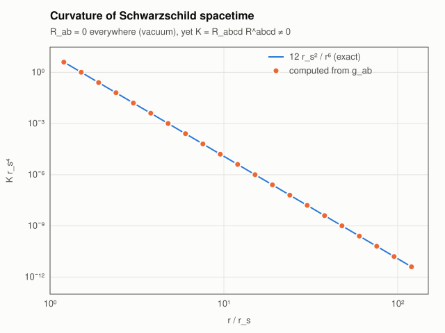
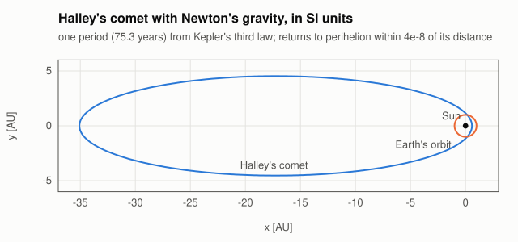
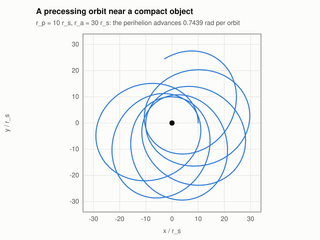
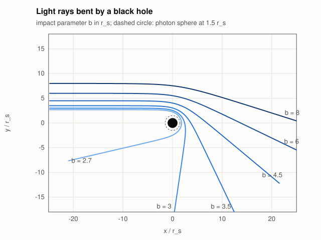

# Examples: gravity

Four worked problems from Newtonian gravity and general relativity. Each one is a runnable example that checks its result against an analytic or published value and fails if it does not match; CI runs all of them. The figures are drawn from the examples' own output (`python3 scripts/make_figures.py`).

| Example | Problem | What it shows |
| --- | --- | --- |
| [`grav01_schwarzschild_curvature`](#1-curvature-of-schwarzschild-spacetime) | curvature outside a star or black hole | defining your own spacetime; Riemann, Ricci and the Kretschmann scalar from the metric alone |
| [`grav02_kepler`](#2-halleys-comet) | Halley's comet | an ODE in SI units whose right-hand side is checked for dimensions |
| [`grav03_perihelion`](#3-the-perihelion-of-mercury) | the 43″ per century of Mercury | the geodesic equation as an ODE; cross-check by quadrature |
| [`grav04_light_bending`](#4-the-bending-of-light) | 1.75″ at the edge of the Sun | null geodesics; rays around a black hole |

Run one with `cargo run --release -p tensorcheck-numerics --example <name>`.

The examples share [`examples/common/mod.rs`](../crates/tensorcheck-numerics/examples/common/mod.rs), which defines Schwarzschild spacetime **outside the library**, the same way you would define your own:

```rust
tensorcheck::space!(pub Exterior, 4, Length);
tensorcheck::chart!(pub Schw on Exterior { CT: Length, R: Length, Theta: Dimensionless, Phi: Dimensionless });

/// ds² = (1 − r_s/r) c²dt² − dr²/(1 − r_s/r) − r²(dθ² + sin²θ dφ²)
impl Metric for SchwarzschildMetric {
    type Chart = Schw;
    type Dim = Dimensionless;
    fn components<N: Scalar>(&self, p: &Point<Schw, N>) -> [N; 10] {
        let r = p.coord(R);
        let f = N::one() - N::from_f64(self.rs) / r;
        let st = p.coord(Theta).sin();
        let z = N::zero();
        [f, z, z, z, -(N::one() / f), z, z, -(r * r), z, -(r * r * st * st)]
    }
}
```

The ten numbers are the upper triangle of $`g_{ab}`$. The components are written generically over `N: Scalar`, so the library evaluates them with dual numbers and gets exact derivatives: you never write a Christoffel symbol by hand. Since `r` is a length and `θ` is dimensionless, $`g_{rr}`$ and $`g_{\theta\theta}`$ have different dimensions, and the library tracks that per component.

## 1. Curvature of Schwarzschild spacetime

[`grav01_schwarzschild_curvature.rs`](../crates/tensorcheck-numerics/examples/grav01_schwarzschild_curvature.rs)

Outside a spherical mass, Einstein's equations in vacuum say $`R_{ab} = 0`$. Spacetime is still curved: the Kretschmann scalar is

```math
K = R_{abcd} R^{abcd} = \frac{12\, r_s^2}{r^6}, \qquad r_s = \frac{2GM}{c^2}.
```

```rust
let cv = curvature(&g, &p)?;            // Γ, Riemann, Ricci, Einstein, R in one call
let low = cv.riemann.lower(slot::_0, &g, &p);
let up = cv.riemann
    .raise(slot::_1, &g, &p)
    .and_then(|t| t.raise(slot::_2, &g, &p))
    .and_then(|t| t.raise(slot::_3, &g, &p))?;
let k = (low.idx((a, b, c, d)) * up.idx((a, b, c, d))).into_tensor();
let k = k.value_in(m.pow::<-4>());      // K has dimension 1/length⁴
```

Contracting `low.idx((a, b, c, d))` with `low.idx((a, b, c, d))` (two lower `a`s) would not compile.



Result, from 1.2 r_s to 120 r_s: $`K`$ matches $`12 r_s^2/r^6`$ to $`2\times10^{-14}`$. The Ricci tensor is checked separately, component by component in the orthonormal frame, $`R_{\hat a\hat b} = R_{ab}/\sqrt{|g_{aa}g_{bb}|}`$ (the metric tensor is diagonal): every component is below $`2\times10^{-14}\sqrt{K}`$. A scalar such as $`R_{ab}R^{ab}`$ would not do, because with a Lorentzian metric nonzero components can cancel in it.

## 2. Halley's comet

[`grav02_kepler.rs`](../crates/tensorcheck-numerics/examples/grav02_kepler.rs)

Newton's law of gravitation, $`\ddot{\boldsymbol{x}} = -GM\,\boldsymbol{x}/|\boldsymbol{x}|^3`$, solved for one period of Halley's comet ($`a = 17.834`$ AU, $`e = 0.967`$) in SI units. The state is a point and a velocity; the right-hand side returns a velocity and an acceleration.

```rust
let rhs = |_t: Quantity<Time>, y: &State| {
    let x = y.0.coord(X) * m;
    let yy = y.0.coord(Y) * m;
    let r = y.0.coord(X).hypot(y.0.coord(Y)) * m;
    let k = gm / r.powi::<3>(); // 1/s²
    let acc: Vector<Acceleration, Cartesian2> = Vector::from_parts((-(k * x), -(k * yy)));
    (y.1, acc)
};
```

Writing `gm / r.powi::<2>()` instead is a compile error:

```text
error[E0277]: component `_0` has the wrong dimension for this vector
```

The initial speed (vis-viva, $`v^2 = GM(2/q - 1/a)`$) and the period (Kepler's third law, $`T = 2\pi\sqrt{a^3/GM}`$) stay typed too. A square root halves every exponent of the dimension:

```rust
let v_q: Quantity<Velocity> = (gm * (2.0 / q - 1.0 / a)).sqrt();
let period: Quantity<Time> = 2.0 * std::f64::consts::PI * (a.powi::<3>() / gm).sqrt();
```

Taking the root of a dimension with an odd exponent, such as $`\sqrt{a^3/(GM\,a)}`$ (dimension $`\mathrm{s^2/m}`$), does not compile:

```text
error[E0277]: cannot take the square root: the dimension has an odd exponent
```



Result: after one period from Kepler's third law (75.3 years, 1018 steps of Dormand–Prince 5(4)), the comet is back at perihelion within $`4\times10^{-8}`$ of the perihelion distance, and the energy is kept to $`2\times10^{-11}`$.

## 3. The perihelion of Mercury

[`grav03_perihelion.rs`](../crates/tensorcheck-numerics/examples/grav03_perihelion.rs)

In general relativity a planet follows a timelike geodesic,

```math
\frac{d^2 x^a}{d\tau^2} = -\Gamma^a{}_{bc}\,\frac{dx^b}{d\tau}\frac{dx^c}{d\tau},
```

and its perihelion advances by $`\Delta\varphi \approx 6\pi GM / \bigl(c^2 a (1 - e^2)\bigr)`$ per orbit. The right-hand side is the geodesic equation written as it reads, with the Christoffel symbols computed from the metric tensor at every step:

```rust
|_tau: Quantity<Time>, y: &GeoState| {
    let gamma = christoffel(&g, &y.0).unwrap();
    (y.1, -(gamma.idx((a, b, c)) * y.1.idx(b) * y.1.idx(c)).into_tensor())
}
```

The example starts Mercury at perihelion, solves for one orbit, and finds the next perihelion (where $`dr/d\tau`$ changes sign) by bisection.

Result: $`5.0187\times10^{-7}`$ rad per orbit, equal to the formula to $`10^{-3}`$, which is **42.98″ per century**.

The same code near a compact object ($`r_p = 10\,r_s`$, $`r_a = 30\,r_s`$) gives a rosette. The advance per orbit, 0.743918321 rad, agrees to nine digits with the exact value

```math
\Delta\varphi = 2\int_{r_p}^{r_a} \frac{d\varphi}{dr}\,dr - 2\pi,
```

computed separately with adaptive Gauss–Kronrod quadrature.



## 4. The bending of light

[`grav04_light_bending.rs`](../crates/tensorcheck-numerics/examples/grav04_light_bending.rs)

Light follows null geodesics: the same equation, with $`g_{ab}\,u^a u^b = 0`$ at the start. The example sends rays past the Sun along $`+x`$ and reads the deflection from the outgoing direction.

| Impact parameter | Computed | $`4GM/c^2 b`$ |
| --- | --- | --- |
| 1 R☉ | 1.75120″ | 1.75119″ |
| 2 R☉ | 0.87560″ | 0.87560″ |
| 5 R☉ | 0.35024″ | 0.35024″ |
| 10 R☉ | 0.17512″ | 0.17512″ |

The small differences ($`6\times10^{-6}`$ at 1 R☉) are the next term of the series, $`\tfrac{15\pi}{4}(GM/c^2 b)^2`$; with it, the computed values agree to $`2\times10^{-7}`$, which is the error of the ODE solve at `rtol = 1e-12`.

Near a black hole the same code bends rays by large angles. Below $`b = \tfrac{3\sqrt{3}}{2} r_s \approx 2.6\,r_s`$ they fall in.



## What is not shown

- There is no event detection in the ODE solvers; `grav03_perihelion` finds perihelia by bisection on the steps.
