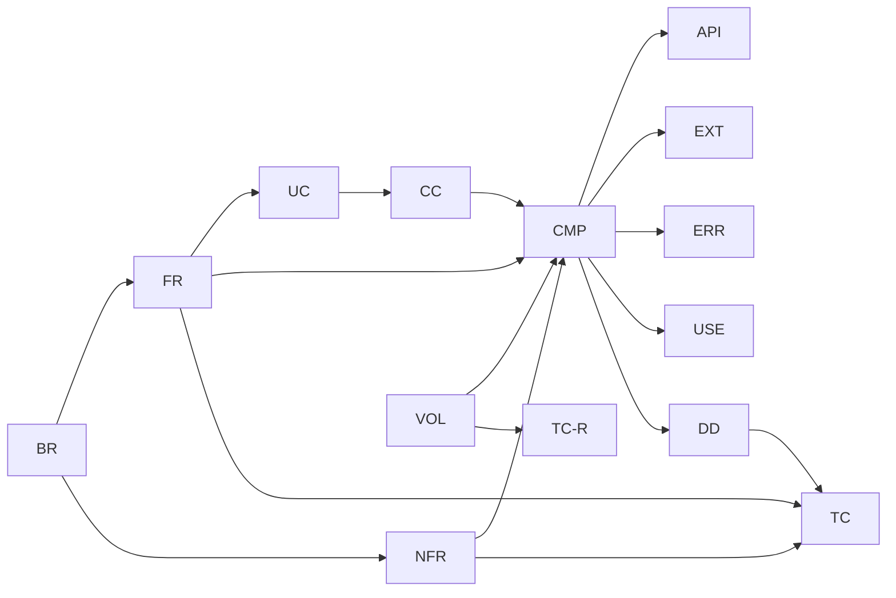

# トレーサビリティ表

要件から設計・テストまでを ID でつなぐ。設計を変える PR では、この表も同じ PR で更新する（[README](README.md) の ID の規則）。
下流の文書（01 以降）ができたら、その対応を順に足す。

## T.1 ビジネス要件 → 機能要件・非機能要件

| BR | FR | NFR |
| --- | --- | --- |
| BR-01 誤りをコンパイル時に見つける | FR-01, FR-02, FR-03, FR-06, FR-07, FR-08, FR-09, FR-10, FR-12, FR-15, FR-16, FR-26, FR-27 | NFR-08, NFR-09 |
| BR-02 座標と場空間を同じ仕組みで | FR-04, FR-05, FR-06, FR-09, FR-11, FR-12, FR-15, FR-25, FR-26, FR-27 | — |
| BR-03 誤りの内容がわかる | FR-03, FR-13, FR-14 | NFR-04, NFR-05, NFR-06, NFR-07, NFR-08 |
| BR-04 書き換えずに対応できる | FR-02, FR-03, FR-04, FR-05, FR-09, FR-11, FR-16, FR-25, FR-28 | NFR-01, NFR-10, NFR-11 |
| BR-05 遅くしない | FR-17 | NFR-01, NFR-02, NFR-03, NFR-12 |
| BR-06 数値計算でも検査を保つ | FR-18, FR-19, FR-20, FR-21, FR-22, FR-23, FR-24, FR-29, FR-30, FR-31 | NFR-09 |
| BR-07 個人情報を含めない | — | NFR-13, NFR-14 |

## T.2 機能要件 → コアユースケース

| FR | UC | 状態 |
| --- | --- | --- |
| FR-01 次元つきの量 | UC-01 | 初期 |
| FR-02 単位系の定義 | UC-01, UC-06 | 初期 |
| FR-03 単位を指定した入出力 | UC-01, UC-06 | 初期 |
| FR-04 空間の定義 | UC-03, UC-06 | 初期 |
| FR-05 座標系の定義 | UC-02, UC-03, UC-04, UC-06 | 初期 |
| FR-06 任意の階数のテンソル | UC-01, UC-02, UC-03 | 初期 |
| FR-07 縮約 | UC-02, UC-03 | 初期 |
| FR-08 足し算・外積・トレース | UC-01 | 初期 |
| FR-09 計量テンソルと上げ下げ | UC-02, UC-03, UC-06 | 初期 |
| FR-10 対称性 | UC-03 | 初期 |
| FR-11 座標系の変換 | UC-04 | 初期 |
| FR-12 成分の取り出し | UC-02 | 初期 |
| FR-13 エラー文 | UC-05 | 初期 |
| FR-14 例題 | —（UC-01〜UC-04、UC-07〜UC-09 を実行できる形にしたもの。応用の例題（重力）は UC-06〜UC-09 の組み合わせ） | 初期 |
| FR-15 共変微分 | UC-09 | 初期 |
| FR-16 自動微分の数値の型 | UC-09 | 初期 |
| FR-17 圧縮した持ち方 | — | 将来 |
| FR-18 常微分方程式 | UC-07, UC-09 | 初期 |
| FR-19 硬い常微分方程式 | UC-07 | 初期 |
| FR-20 定積分 | UC-08 | 初期 |
| FR-21 数値微分 | UC-07 | 初期 |
| FR-22 誤差の許容値と失敗の知らせ | UC-07, UC-08 | 初期 |
| FR-31 イベント検出 | UC-07 | 初期 |
| FR-30 利用者が与える Jacobi 行列 | UC-07 | 初期 |
| FR-23 陰的解法（Radau IIA・BDF） | — | 将来 |
| FR-24 無限区間・多次元の積分 | — | 将来 |
| FR-25 テンソル場 | UC-09 | 初期 |
| FR-26 Christoffel 記号 | UC-09 | 初期 |
| FR-27 曲率 | UC-09 | 初期 |
| FR-28 ほかの数値型 | — | 将来 |
| FR-29 シンプレクティック法 | — | 将来 |

## T.3 変動性 → 構成要素

| VOL | 構成要素 |
| --- | --- |
| VOL-01 単位系 | CMP-E01 DimensionEngine |
| VOL-02 単位 | CMP-E01 DimensionEngine |
| VOL-03 空間 | CMP-E02 IndexEngine |
| VOL-04 座標系 | CMP-E02 IndexEngine |
| VOL-05 計量テンソル | CMP-E03 MetricEngine |
| VOL-06 対称性 | CMP-E04 SymmetryEngine |
| VOL-07 常微分方程式の解法 | CMP-E05 OdeStepEngine |
| VOL-08 誤差の測り方と刻みの調整 | CMP-E06 ErrorControlEngine |
| VOL-09 定積分の解法 | CMP-E07 QuadratureEngine |
| VOL-10 微分の求め方 | CMP-E08 DifferentiationEngine |
| VOL-11 成分の持ち方 | CMP-A01 ComponentAccess |
| VOL-12 数値の型 | CMP-U02 Scalar |
| VOL-13 ユースケースの手順 | CMP-M01 TensorManager、CMP-M03 GeometryManager、CMP-M02 SolverManager |
| VOL-14 接続 | CMP-E09 ConnectionEngine |

## T.4 要件 → 構成要素

| 要件 | 構成要素 |
| --- | --- |
| FR-01 次元つきの量 | CMP-M01, CMP-E01 |
| FR-02 単位系の定義 | CMP-E01 |
| FR-03 単位を指定した入出力 | CMP-M01, CMP-E01 |
| FR-04 空間の定義 | CMP-E02 |
| FR-05 座標系の定義 | CMP-E02 |
| FR-06 任意の階数のテンソル | CMP-M01, CMP-E01, CMP-E02, CMP-A01 |
| FR-07 縮約 | CMP-M01, CMP-E02, CMP-A01 |
| FR-08 足し算・外積・トレース | CMP-M01, CMP-E01, CMP-E02, CMP-E04, CMP-A01 |
| FR-09 計量テンソルと上げ下げ | CMP-M01, CMP-E02, CMP-E03, CMP-U04 |
| FR-10 対称性 | CMP-M01, CMP-E04 |
| FR-11 座標系の変換 | CMP-M01, CMP-E02, CMP-U04 |
| FR-12 成分の取り出し | CMP-M01, CMP-E01, CMP-E02, CMP-A01 |
| FR-13 エラー文 | CMP-U03 |
| FR-14 例題 | CMP-C02 |
| FR-15 共変微分 | CMP-M03, CMP-E02, CMP-E08, CMP-E09 |
| FR-16 自動微分の数値の型 | CMP-U02, CMP-E08 |
| FR-17 圧縮した持ち方 | CMP-A01（将来） |
| FR-18 常微分方程式 | CMP-M02, CMP-E05, CMP-E06, CMP-U05 |
| FR-19 硬い常微分方程式 | CMP-M02, CMP-E05, CMP-E06, CMP-E08, CMP-U04 |
| FR-20 定積分 | CMP-M02, CMP-E06, CMP-E07, CMP-U05 |
| FR-21 数値微分 | CMP-M02, CMP-E08 |
| FR-22 誤差の許容値と失敗の知らせ | CMP-M02, CMP-E06 |
| FR-31 イベント検出 | CMP-M02, CMP-E05 |
| FR-30 利用者が与える Jacobi 行列 | CMP-M02, CMP-E05 |
| FR-23 陰的解法（Radau IIA・BDF） | CMP-E05, CMP-U04（将来） |
| FR-24 無限区間・多次元の積分 | CMP-E07（将来） |
| FR-25 テンソル場 | CMP-M03, CMP-E08 |
| FR-26 Christoffel 記号 | CMP-M03, CMP-E02, CMP-E03, CMP-E08, CMP-E09 |
| FR-27 曲率 | CMP-M03, CMP-E02, CMP-E03, CMP-E04, CMP-E08, CMP-E09 |
| FR-28 ほかの数値型 | CMP-U02（将来） |
| FR-29 シンプレクティック法 | CMP-E05（将来） |
| NFR-01 stable・std・依存なし | すべて（01 §1.8） |
| NFR-03 型の情報は実行時の大きさを持たない | CMP-U01, CMP-A01 |
| NFR-05 エラー文は見出しでわかる | CMP-U03 |
| NFR-07 英語 | CMP-U03, CMP-C02 |
| NFR-10 変化は 1 つの構成要素で | §T.3 |
| NFR-11 呼び出しの規則を CI で検査 | 01 §1.7 |

## T.5 コアユースケース → Manager

| UC | Manager | 主な Engine |
| --- | --- | --- |
| UC-01 次元の検査 | CMP-M01 | E01, E02 |
| UC-02 曲線座標 | CMP-M01 | E02, E03 |
| UC-03 場空間と時空 | CMP-M01 | E02, E03, E04 |
| UC-04 座標変換 | CMP-M01 | E02 |
| UC-05 エラー文から直す | CMP-M01（エラー文は CMP-U03） | E01〜E04 |
| UC-06 利用者が定義する | —（拡張点の実装） | E01, E02, E03 |
| UC-07 常微分方程式 | CMP-M02 | E05, E06, E08 |
| UC-08 定積分 | CMP-M02 | E06, E07 |
| UC-09 接続と曲率、測地線 | CMP-M03（測地線は CMP-M02） | E02, E03, E08, E09 |

## T.6 コアユースケース → コールチェーン → 構成要素

| UC | CC | 通る構成要素 |
| --- | --- | --- |
| UC-01 | CC-01 | C01, M01, E01, A01 |
| UC-02 | CC-02 | C01, M01, E01, E02, E03, A01 |
| UC-03 | CC-03 | C01, M01, E01, E02, E03, E04, A01 |
| UC-04 | CC-04 | C01, M01, E02, E04, A01, U04 |
| UC-05 | CC-05 | M01, E01, E02, E04, U03 |
| UC-06 | CC-06 | C01（拡張点の実装） |
| UC-07 | CC-07 | C01, M02, E05, E06, E08, U04, U05 |
| UC-08 | CC-08 | C01, M02, E06, E07, U05 |
| UC-09 | CC-09 | C01, M03, E01, E02, E03, E04, E08, E09, A01, U02, U04（測地線は CC-07 も） |

## T.7 構成要素からの逆引き

| 構成要素 | 変動性 | 要件 | CC |
| --- | --- | --- | --- |
| CMP-M01 TensorManager | VOL-13 | FR-01, FR-03, FR-06〜FR-12 | CC-01〜CC-05 |
| CMP-M02 SolverManager | VOL-13 | FR-18〜FR-22, FR-30, FR-31 | CC-07, CC-08 |
| CMP-M03 GeometryManager | VOL-13 | FR-15, FR-25〜FR-27 | CC-09 |
| CMP-E01 DimensionEngine | VOL-01, VOL-02 | FR-01〜FR-03, FR-06, FR-08, FR-12 | CC-01〜CC-03, CC-05, CC-09 |
| CMP-E02 IndexEngine | VOL-03, VOL-04 | FR-04〜FR-09, FR-11, FR-12, FR-15, FR-26, FR-27 | CC-02〜CC-05, CC-09 |
| CMP-E03 MetricEngine | VOL-05 | FR-09, FR-26, FR-27 | CC-02, CC-03, CC-09 |
| CMP-E04 SymmetryEngine | VOL-06 | FR-08, FR-10, FR-27 | CC-03〜CC-05, CC-09 |
| CMP-E05 OdeStepEngine | VOL-07 | FR-18, FR-19, FR-23, FR-30, FR-31 | CC-07 |
| CMP-E06 ErrorControlEngine | VOL-08 | FR-18〜FR-20, FR-22 | CC-07, CC-08 |
| CMP-E07 QuadratureEngine | VOL-09 | FR-20, FR-24 | CC-08 |
| CMP-E08 DifferentiationEngine | VOL-10 | FR-15, FR-16, FR-19, FR-21, FR-25〜FR-27 | CC-07, CC-09 |
| CMP-E09 ConnectionEngine | VOL-14 | FR-15, FR-26, FR-27 | CC-09 |
| CMP-A01 ComponentAccess | VOL-11 | FR-06〜FR-08, FR-12, FR-17 | CC-01〜CC-04, CC-09 |
| CMP-U01 TypeLevel | — | NFR-01, NFR-03 | すべて（型の層） |
| CMP-U02 Scalar | VOL-12 | FR-16, FR-28 | すべて（値の層） |
| CMP-U03 Diagnostics | — | FR-13, NFR-05, NFR-07 | CC-05 |
| CMP-U04 LinearSolve | — | FR-09, FR-11, FR-19, FR-23 | CC-02〜CC-04, CC-07, CC-09 |
| CMP-U05 VectorSpace | — | FR-18, FR-20, FR-21 | CC-07, CC-08 |

## T.8 機能要件 → 外部インターフェース

| FR | API | EXT | ERR |
| --- | --- | --- | --- |
| FR-01 次元つきの量 | API-02, API-20, API-25, API-38, API-39, API-56 | — | ERR-01, ERR-22 |
| FR-02 単位系の定義 | API-05, API-06, API-07 | EXT-01 | — |
| FR-03 単位を指定した入出力 | API-20, API-21, API-23 | EXT-02 | ERR-02 |
| FR-04 空間の定義 | API-11 | EXT-03 | — |
| FR-05 座標系の定義 | API-03, API-10, API-11 | EXT-04 | — |
| FR-06 任意の階数のテンソル | API-01, API-02, API-03, API-21, API-34, API-35 | — | ERR-03, ERR-21 |
| FR-07 縮約 | API-08, API-27, API-28, API-30 | — | ERR-04, ERR-05, ERR-06, ERR-07, ERR-08 |
| FR-08 足し算・外積・トレース | API-25, API-26, API-29 | — | ERR-01, ERR-03, ERR-13, ERR-17 |
| FR-09 計量テンソルと上げ下げ | API-09, API-11, API-31, API-36 | EXT-06 | ERR-09, ERR-20 |
| FR-10 対称性 | API-04, API-22, API-33, API-37 | — | ERR-12, ERR-13 |
| FR-11 座標系の変換 | API-11, API-32 | EXT-05 | ERR-10, ERR-16 |
| FR-12 成分の取り出し | API-24 | — | ERR-11 |
| FR-13 エラー文 | — | — | ERR-01〜ERR-24 |
| FR-14 例題 | §2a.2 の使い方の例 | — | — |
| FR-15 共変微分 | API-16, API-54 | EXT-08 | ERR-17 |
| FR-16 自動微分の数値の型 | API-17 | EXT-06, EXT-08 | ERR-18 |
| FR-18 常微分方程式 | API-12, API-13, API-40, API-42, API-43, API-44, API-45 | EXT-07 | ERR-14, ERR-15 |
| FR-19 硬い常微分方程式 | API-42 | EXT-07 | — |
| FR-20 定積分 | API-14, API-46, API-47, API-48 | EXT-07 | — |
| FR-21 数値微分 | API-15, API-49 | EXT-07 | — |
| FR-22 誤差の許容値と失敗の知らせ | API-43, API-44, API-47, API-48, API-57 | — | ERR-15 |
| FR-31 イベント検出 | API-58, API-59 | — | ERR-14, ERR-15 |
| FR-30 利用者が与える Jacobi 行列 | API-42, API-60 | — | ERR-01, ERR-21, ERR-23, ERR-24 |
| FR-25 テンソル場 | API-55 | EXT-08 | ERR-18 |
| FR-26 Christoffel 記号 | API-16, API-50, API-51, API-53 | EXT-06 | ERR-16, ERR-17, ERR-19 |
| FR-27 曲率 | API-16, API-52, API-53 | EXT-06 | — |

将来の FR（FR-17、FR-23、FR-24、FR-28、FR-29）は、外部インターフェースをまだ持たない。API-41 は廃止。

## T.10 詳細設計 → 構成要素・要件

| DD | 構成要素 | 主な要件 |
| --- | --- | --- |
| DD-01 ファイル配置と呼び出しの規則 | すべて | NFR-10, NFR-11, NFR-12 |
| DD-02 型レベルの整数・真偽・並び | CMP-U01 | NFR-01, NFR-03 |
| DD-03 次元と単位 | CMP-E01 | FR-01, FR-02, FR-03 |
| DD-04 空間・座標系・点と成分の持ち方 | CMP-E02, CMP-A01 | FR-04, FR-05, FR-06, FR-12, NFR-02, NFR-03 |
| DD-05 テンソルの型と基本の演算 | CMP-M01 | FR-01, FR-03, FR-06, FR-08 |
| DD-06 ラベルと縮約 | CMP-E02, CMP-M01 | FR-07, FR-08 |
| DD-07 対称性 | CMP-E04, CMP-A01 | FR-10 |
| DD-08 計量テンソル・座標変換・逆行列 | CMP-E03, CMP-E02, CMP-U04 | FR-09, FR-11 |
| DD-09 数値の型と自動微分 | CMP-U02, CMP-E08 | FR-16, FR-25 |
| DD-10 接続と曲率、共変微分 | CMP-E09, CMP-M03 | FR-15, FR-26, FR-27 |
| DD-11 数値解法の状態 | CMP-U05 | FR-18, FR-20 |
| DD-12 常微分方程式の解法 | CMP-E05, CMP-M02 | FR-18, FR-19, FR-31 |
| DD-13 誤差の測り方と刻み幅の調整 | CMP-E06 | FR-18, FR-20, FR-22 |
| DD-14 定積分 | CMP-E07, CMP-M02 | FR-20 |
| DD-15 差分による数値微分 | CMP-E08 | FR-19, FR-21, FR-30 |
| DD-16 エラー文の実装 | CMP-U03 | FR-13, NFR-05, NFR-08 |
| DD-17 失敗の型 | CMP-M02, CMP-U04 | FR-22 |
| DD-18 利用者向けのマクロ | C01 向け | FR-02, FR-04, FR-05 |
| DD-19 試作で確かめたこと | — | NFR-01, NFR-02, NFR-03 |
| DD-20 ビルドと CI | — | NFR-11, NFR-13, NFR-14 |

## T.11 要件 → テスト

| 要件 | テスト |
| --- | --- |
| FR-01 次元つきの量 | TC-U01, TC-U02, TC-I01, TC-F01, TC-F23, TC-E01, TC-E09 |
| FR-02 単位系の定義 | TC-U02, TC-R01 |
| FR-03 単位を指定した入出力 | TC-U02, TC-F02, TC-R02 |
| FR-04 空間の定義 | TC-I03, TC-R03 |
| FR-05 座標系の定義 | TC-I05, TC-R04 |
| FR-06 任意の階数のテンソル | TC-U03, TC-F03 |
| FR-07 縮約 | TC-U04, TC-U13, TC-F04, TC-F05, TC-F06, TC-F07, TC-F08 |
| FR-08 足し算・外積・トレース | TC-U04, TC-F01, TC-F03, TC-F13 |
| FR-09 計量テンソルと上げ下げ | TC-U07, TC-I02, TC-I03, TC-F09, TC-F21, TC-R05 |
| FR-10 対称性 | TC-U06, TC-F12, TC-F13 |
| FR-11 座標系の変換 | TC-U08, TC-I04, TC-F10, TC-R04 |
| FR-12 成分の取り出し | TC-U05, TC-F11 |
| FR-13 エラー文 | TC-F01〜TC-F18, TC-F20〜TC-F28 |
| FR-14 例題 | TC-E01〜TC-E11 |
| FR-15 共変微分 | TC-U12 |
| FR-16 自動微分の数値の型 | TC-U09, TC-F18 |
| FR-18 常微分方程式 | TC-U23, TC-I06, TC-F14, TC-F15 |
| FR-19 硬い常微分方程式 | TC-U25, TC-E05 |
| FR-20 定積分 | TC-U21, TC-U22, TC-I07, TC-E06 |
| FR-21 数値微分 | TC-U26 |
| FR-22 誤差の許容値と失敗の知らせ | TC-U20, TC-U27, TC-U28 |
| FR-31 イベント検出 | TC-U29, TC-E10 |
| FR-30 利用者が与える Jacobi 行列 | TC-U30, TC-F24, TC-F25, TC-F26, TC-F27, TC-F28, TC-E05 |
| FR-25 テンソル場 | TC-U12 |
| FR-26 Christoffel 記号 | TC-U10, TC-U14, TC-F16, TC-F17, TC-F20 |
| FR-27 曲率 | TC-U11, TC-U14, TC-U15, TC-U16, TC-I08, TC-E07 |
| NFR-01 std・依存なし | TC-A03 |
| NFR-02 実行時のコストなし | TC-N01 |
| NFR-03 型の大きさ | TC-U03, TC-N02 |
| NFR-04 コンパイル時間 | TC-N03 |
| NFR-05 見出しでわかるエラー文 | TC-F01〜TC-F17, TC-F20 |
| NFR-06 ドキュメント | TC-N04 |
| NFR-07 英語 | TC-N05 |
| NFR-08 コンパイル失敗のテスト | TC-N06, TC-F19 |
| NFR-09 数値の正しさ | TC-U07〜TC-U12, TC-U14〜TC-U16, TC-U21〜TC-U26, TC-I01〜TC-I08 |
| NFR-10 変化は 1 つの構成要素で | TC-R01〜TC-R05（VOL-06〜VOL-14 はレビュー） |
| NFR-11 呼び出しの規則 | TC-A01, TC-A04 |
| NFR-12 `unsafe` なし | TC-A02 |
| NFR-13 個人情報 | TC-N07 |
| NFR-14 セキュリティ | TC-N08 |

## T.9 外部から利用するもの → 要件

| USE | 要件 |
| --- | --- |
| USE-01 Rust と std | NFR-01 |
| USE-02 診断機能 | FR-13, NFR-05 |
| USE-03 workspace | NFR-01（01 §1.8） |
| USE-04 Cargo の JSON 出力（コンパイル失敗のテスト） | NFR-08 |
| USE-05 ベンチマーク | NFR-02, NFR-04 |
| USE-06 GitHub Actions | NFR-11, NFR-13, NFR-14 |
| USE-07 Python 3 | NFR-11, NFR-13 |
| USE-08 Dependabot、secret scanning | NFR-14 |
