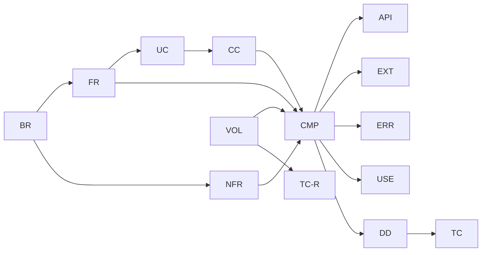

# トレーサビリティ表

要件から設計・テストまでを ID でつなぐ。設計を変える PR では、この表も同じ PR で更新する（[README](README.md) の ID の規則）。
下流の文書（01 以降）ができたら、その対応を順に足す。

## T.1 ビジネス要件 → 機能要件・非機能要件

| BR | FR | NFR |
| --- | --- | --- |
| BR-01 誤りをコンパイル時に見つける | FR-01, FR-02, FR-03, FR-06, FR-07, FR-08, FR-09, FR-10, FR-12, FR-15 | NFR-08, NFR-09 |
| BR-02 座標と場空間を同じ仕組みで | FR-04, FR-05, FR-06, FR-09, FR-11, FR-12 | — |
| BR-03 誤りの内容がわかる | FR-03, FR-13, FR-14 | NFR-04, NFR-05, NFR-06, NFR-07, NFR-08 |
| BR-04 書き換えずに対応できる | FR-02, FR-03, FR-04, FR-05, FR-09, FR-11, FR-16 | NFR-01, NFR-10, NFR-11 |
| BR-05 遅くしない | FR-17 | NFR-01, NFR-02, NFR-03, NFR-12 |
| BR-06 数値計算でも検査を保つ | FR-18, FR-19, FR-20, FR-21, FR-22, FR-23, FR-24 | NFR-09 |
| BR-07 個人情報を含めない | — | NFR-13, NFR-14 |

## T.2 機能要件 → コアユースケース

| FR | UC | 状態 |
| --- | --- | --- |
| FR-01 次元つきの量 | UC-01 | 初期 |
| FR-02 単位系の定義 | UC-01, UC-06 | 初期 |
| FR-03 単位を指定した入出力 | UC-01, UC-06 | 初期 |
| FR-04 空間の定義 | UC-03, UC-06 | 初期 |
| FR-05 座標系の定義 | UC-02, UC-03, UC-04, UC-06 | 初期 |
| FR-06 任意の階数のテンソル | UC-01, UC-02, UC-03 | 初期 |
| FR-07 Einstein の規約による縮約 | UC-02, UC-03 | 初期 |
| FR-08 足し算・外積・トレース | UC-01 | 初期 |
| FR-09 計量と上げ下げ | UC-02, UC-03, UC-06 | 初期 |
| FR-10 対称性 | UC-03 | 初期 |
| FR-11 座標系の変換 | UC-04 | 初期 |
| FR-12 成分の取り出し | UC-02 | 初期 |
| FR-13 エラー文 | UC-05 | 初期 |
| FR-14 例題 | —（UC-01〜UC-04、UC-07、UC-08 を実行できる形にしたもの） | 初期 |
| FR-15 共変微分 | — | 将来 |
| FR-16 ほかの数値型 | — | 将来 |
| FR-17 圧縮した持ち方 | — | 将来 |
| FR-18 常微分方程式 | UC-07 | 初期 |
| FR-19 硬い常微分方程式 | UC-07 | 初期 |
| FR-20 定積分 | UC-08 | 初期 |
| FR-21 数値微分 | UC-07 | 初期 |
| FR-22 誤差の許容値と失敗の知らせ | UC-07, UC-08 | 初期 |
| FR-23 陰的解法（Radau IIA・BDF） | — | 将来 |
| FR-24 無限区間・多次元の積分 | — | 将来 |

## T.3 変動性 → 構成要素

| VOL | 構成要素 |
| --- | --- |
| VOL-01 単位系 | CMP-E01 DimensionEngine |
| VOL-02 単位 | CMP-E01 DimensionEngine |
| VOL-03 空間 | CMP-E02 IndexEngine |
| VOL-04 座標系 | CMP-E02 IndexEngine |
| VOL-05 計量 | CMP-E03 MetricEngine |
| VOL-06 対称性 | CMP-E04 SymmetryEngine |
| VOL-07 常微分方程式の解法 | CMP-E05 OdeStepEngine |
| VOL-08 誤差の測り方と刻みの調整 | CMP-E06 ErrorControlEngine |
| VOL-09 定積分の解法 | CMP-E07 QuadratureEngine |
| VOL-10 数値微分の方式 | CMP-E08 DifferentiationEngine |
| VOL-11 成分の持ち方 | CMP-A01 ComponentAccess |
| VOL-12 数値の型 | CMP-U02 Scalar |
| VOL-13 ユースケースの手順 | CMP-M01 TensorManager、CMP-M02 SolverManager |

## T.4 要件 → 構成要素

| 要件 | 構成要素 |
| --- | --- |
| FR-01 次元つきの量 | CMP-M01, CMP-E01 |
| FR-02 単位系の定義 | CMP-E01 |
| FR-03 単位を指定した入出力 | CMP-M01, CMP-E01 |
| FR-04 空間の定義 | CMP-E02 |
| FR-05 座標系の定義 | CMP-E02 |
| FR-06 任意の階数のテンソル | CMP-M01, CMP-E01, CMP-E02, CMP-A01 |
| FR-07 縮約 | CMP-M01, CMP-E02, CMP-A01 |
| FR-08 足し算・外積・トレース | CMP-M01, CMP-E01, CMP-E02, CMP-E04, CMP-A01 |
| FR-09 計量と上げ下げ | CMP-M01, CMP-E02, CMP-E03, CMP-U04 |
| FR-10 対称性 | CMP-M01, CMP-E04 |
| FR-11 座標系の変換 | CMP-M01, CMP-E02, CMP-U04 |
| FR-12 成分の取り出し | CMP-M01, CMP-E01, CMP-E02, CMP-A01 |
| FR-13 エラー文 | CMP-U03 |
| FR-14 例題 | CMP-C02 |
| FR-15 共変微分（将来） | CMP-M01, CMP-E03（接続を計量から求める） |
| FR-16 ほかの数値型（将来） | CMP-U02 |
| FR-17 圧縮した持ち方（将来） | CMP-A01 |
| FR-18 常微分方程式 | CMP-M02, CMP-E05, CMP-E06, CMP-U05 |
| FR-19 硬い常微分方程式 | CMP-M02, CMP-E05, CMP-E06, CMP-E08, CMP-U04 |
| FR-20 定積分 | CMP-M02, CMP-E06, CMP-E07, CMP-U05 |
| FR-21 数値微分 | CMP-M02, CMP-E08 |
| FR-22 誤差の許容値と失敗の知らせ | CMP-M02, CMP-E06 |
| FR-23 陰的解法（将来） | CMP-E05, CMP-U04 |
| FR-24 無限区間・多次元の積分（将来） | CMP-E07 |
| NFR-01 stable・`no_std`・依存なし | すべて（01 §1.8） |
| NFR-03 型の情報は実行時の大きさを持たない | CMP-U01, CMP-A01 |
| NFR-05 エラー文は見出しでわかる | CMP-U03 |
| NFR-07 英語 | CMP-U03、CMP-C02 |
| NFR-10 変化は 1 つの構成要素で | §T.3 |
| NFR-11 呼び出しの規則を CI で検査 | 01 §1.7 |

## T.5 コアユースケース → Manager

| UC | Manager | 主な Engine |
| --- | --- | --- |
| UC-01 次元の検査 | CMP-M01 | E01, E02 |
| UC-02 曲線座標 | CMP-M01 | E02, E03 |
| UC-03 場空間と時空 | CMP-M01 | E02, E03, E04 |
| UC-04 座標変換 | CMP-M01 | E02 |
| UC-05 エラー文から直す | CMP-M01（エラー文は CMP-U03） | E01〜E04 |
| UC-06 利用者が定義する | —（拡張点の実装） | E01, E02, E03 |
| UC-07 常微分方程式 | CMP-M02 | E05, E06, E08 |
| UC-08 定積分 | CMP-M02 | E06, E07 |

## T.6 コアユースケース → コールチェーン → 構成要素

| UC | CC | 通る構成要素 |
| --- | --- | --- |
| UC-01 | CC-01 | C01, M01, E01, A01 |
| UC-02 | CC-02 | C01, M01, E01, E02, E03, A01 |
| UC-03 | CC-03 | C01, M01, E01, E02, E03, E04, A01 |
| UC-04 | CC-04 | C01, M01, E02, E04, A01, U04 |
| UC-05 | CC-05 | M01, E01, E02, E04, U03 |
| UC-06 | CC-06 | C01（拡張点の実装） |
| UC-07 | CC-07 | C01, M02, E05, E06, E08, U04, U05 |
| UC-08 | CC-08 | C01, M02, E06, E07, U05 |

## T.7 構成要素からの逆引き

| 構成要素 | 変動性 | 要件 | CC |
| --- | --- | --- | --- |
| CMP-M01 TensorManager | VOL-13 | FR-01, FR-03, FR-06〜FR-12, FR-15 | CC-01〜CC-05 |
| CMP-M02 SolverManager | VOL-13 | FR-18〜FR-22 | CC-07, CC-08 |
| CMP-E01 DimensionEngine | VOL-01, VOL-02 | FR-01〜FR-03, FR-06, FR-08, FR-12 | CC-01〜CC-03, CC-05 |
| CMP-E02 IndexEngine | VOL-03, VOL-04 | FR-04〜FR-09, FR-11, FR-12 | CC-02〜CC-05 |
| CMP-E03 MetricEngine | VOL-05 | FR-09, FR-15 | CC-02, CC-03 |
| CMP-E04 SymmetryEngine | VOL-06 | FR-08, FR-10 | CC-03〜CC-05 |
| CMP-E05 OdeStepEngine | VOL-07 | FR-18, FR-19, FR-23 | CC-07 |
| CMP-E06 ErrorControlEngine | VOL-08 | FR-18〜FR-20, FR-22 | CC-07, CC-08 |
| CMP-E07 QuadratureEngine | VOL-09 | FR-20, FR-24 | CC-08 |
| CMP-E08 DifferentiationEngine | VOL-10 | FR-19, FR-21 | CC-07 |
| CMP-A01 ComponentAccess | VOL-11 | FR-06〜FR-08, FR-12, FR-17 | CC-01〜CC-04 |
| CMP-U01 TypeLevel | — | NFR-01, NFR-03 | すべて（型の層） |
| CMP-U02 Scalar | VOL-12 | FR-16 | すべて（値の層） |
| CMP-U03 Diagnostics | — | FR-13, NFR-05, NFR-07 | CC-05 |
| CMP-U04 LinearSolve | — | FR-09, FR-11, FR-19, FR-23 | CC-02〜CC-04, CC-07 |
| CMP-U05 VectorSpace | — | FR-18, FR-20, FR-21 | CC-07, CC-08 |
