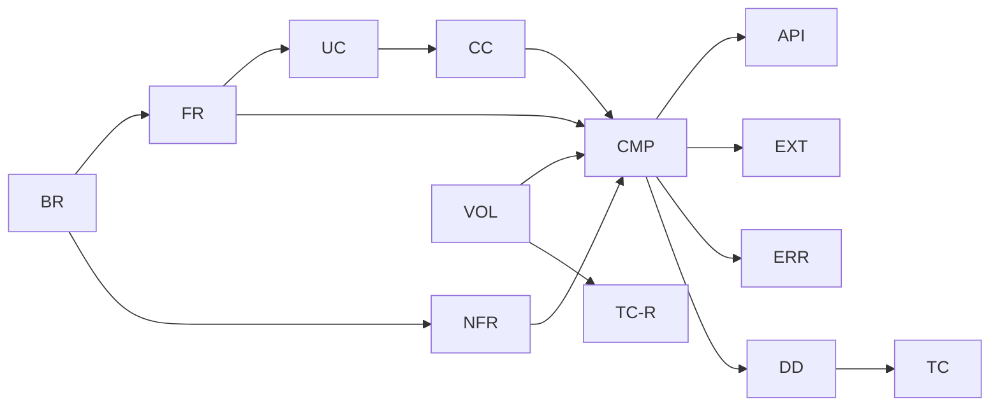

# トレーサビリティ表

要件から設計・テストまでを ID でつなぐ。設計を変える PR では、この表も同じ PR で更新する（[README](README.md) の ID の規則）。
下流の文書（01 以降）ができたら、その対応を順に足す。

## T.1 ビジネス要件 → 機能要件・非機能要件

| BR | FR | NFR |
| --- | --- | --- |
| BR-01 誤りをコンパイル時に見つける | FR-01, FR-03, FR-06, FR-07, FR-08, FR-09, FR-10, FR-12, FR-15 | NFR-07, NFR-08 |
| BR-02 座標と場空間を同じ仕組みで | FR-04, FR-05, FR-06, FR-09, FR-11, FR-12 | — |
| BR-03 誤りの内容がわかる | FR-03, FR-13, FR-14 | NFR-04, NFR-05, NFR-06, NFR-07 |
| BR-04 書き換えずに対応できる | FR-02, FR-04, FR-05, FR-09, FR-11, FR-16 | NFR-01, NFR-09, NFR-10 |
| BR-05 遅くしない | FR-17 | NFR-02, NFR-03, NFR-11 |
| BR-06 能力を示す | FR-14 | NFR-01, NFR-06 |
| BR-07 個人情報を含めない | — | NFR-12, NFR-13 |

## T.2 機能要件 → コアユースケース

| FR | UC | 状態 |
| --- | --- | --- |
| FR-01 次元つきの量 | UC-01 | 初期 |
| FR-02 単位系の定義 | UC-01, UC-06 | 初期 |
| FR-03 単位を指定した入出力 | UC-01 | 初期 |
| FR-04 空間の定義 | UC-03, UC-06 | 初期 |
| FR-05 座標系の定義 | UC-02, UC-03, UC-04, UC-06 | 初期 |
| FR-06 任意の階数のテンソル | UC-01, UC-02, UC-03 | 初期 |
| FR-07 アインシュタインの規約による縮約 | UC-02, UC-03 | 初期 |
| FR-08 足し算・外積・トレース | UC-01 | 初期 |
| FR-09 計量と上げ下げ | UC-02, UC-03, UC-06 | 初期 |
| FR-10 対称性 | UC-03 | 初期 |
| FR-11 座標系の変換 | UC-04 | 初期 |
| FR-12 成分の取り出し | UC-02 | 初期 |
| FR-13 エラー文 | UC-05 | 初期 |
| FR-14 例題 | —（UC-01〜UC-04 を実行できる形にしたもの） | 初期 |
| FR-15 共変微分 | — | 将来 |
| FR-16 ほかの数値型 | — | 将来 |
| FR-17 圧縮した持ち方 | — | 将来 |
